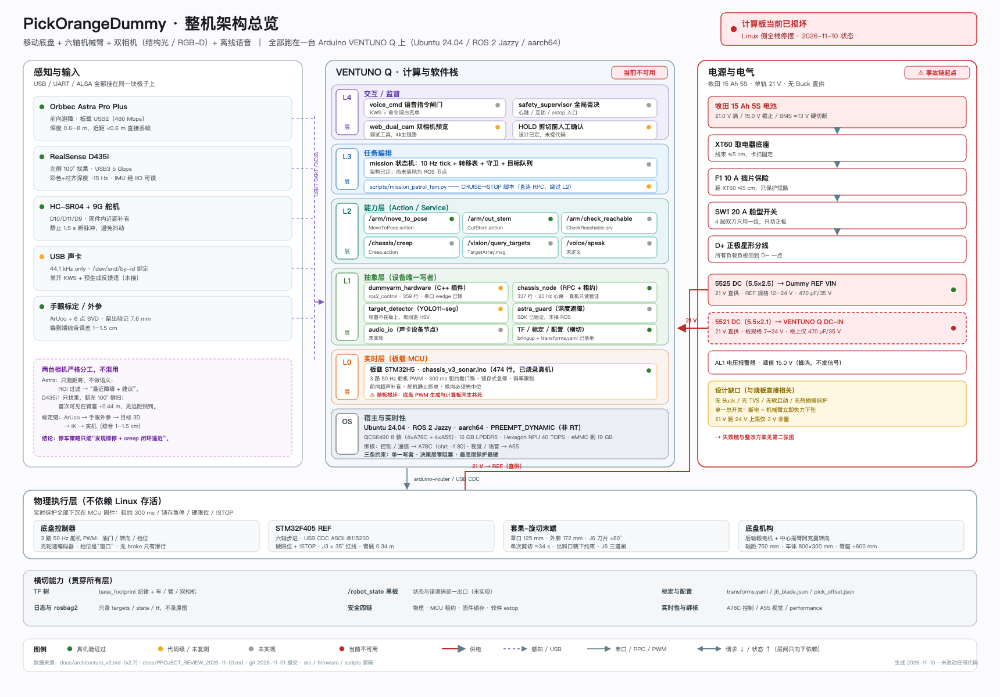
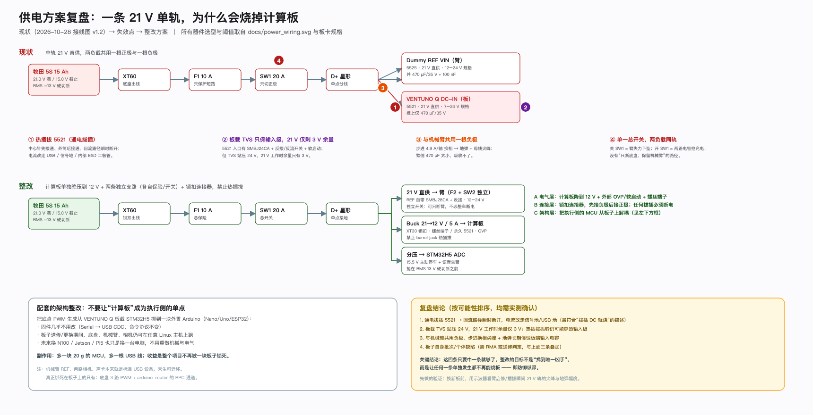

# PickOrangeDummy · 架构复盘与下一步（2026-11-10）

> 本文只做**了解、梳理与建议**，未改动任何代码、固件或配置。
> 与现有文档的关系：`architecture_v2.md` 是**设计基线**（应该长成什么样），本文是**现状层**
> （现在实际长成什么样、哪里对不上、下一步先动哪一块）。
>
> 配套两张图（SVG 手写，可直接编辑，不依赖 mmdc）：
> - 图 1 整机架构总览 → [`diagrams/12-system-overview.svg`](diagrams/12-system-overview.svg)
> - 图 2 供电失效链与整改 → [`diagrams/13-power-failure.svg`](diagrams/13-power-failure.svg)



---

## 0. 一页纸

**项目是什么**：低位柑橘采摘机器人 = 移动底盘 + 六轴机械臂（Dummy V2 复刻）+ 双相机
（Astra 前向避障 / D435i 左侧找果）+ 离线语音，全部跑在一台 Arduino VENTUNO Q 上。

**已经做到哪**：不是"刚起步"。到 2026-11-01 夜，真机上已经跑通
「相机 → 3D 定位 → IK → 套住果实 → 旋转剪切 → 退刀」的单次闭环，
手眼标定留出验证 **7.6 mm**，端到端 **1–1.5 cm**；底盘 PWM、双相机出图、
整车 TF、`chassis_node` 只读链路都验证过。**单次动作层是通的，整机自主闭环还没接上。**

**现在卡在哪**（三件事，按阻塞程度）：

| # | 卡点 | 性质 | 能否绕过 |
|---|---|---|---|
| 1 | **计算板损坏，Linux 侧全栈停摆** | 硬件 | 能——软件本来就该与板子解耦，见 §7.1 |
| 2 | **21 V 单轨供电方案没有防御纵深** | 设计 | 必须改，否则换一块烧一块，见 §5 |
| 3 | **"单一写者"只靠约定，没有代码强制** | 架构债 | 能，但必须在 S2 之前修，见 §4.3 |

**建议的下一步**（详见 §7）：

1. **P0（本周）**：判定板子损坏等级 → 先决定"修还是换"；同时用一台普通 Ubuntu 主机 +
   外置 Arduino 搭"影子平台"，把底盘/机械臂/相机链路跑起来，**让项目不再被一块板子锁死**。
2. **P1（复机前）**：电源改两路独立 Buck + 独立开关 + TVS/反接/软启动 + 锁扣连接器，
   **明令禁止通电拔插**；做不到这四条之前，不要给新板通 21 V。
3. **P2（复机后）**：按 S1 → S2 → S3 推进，先把"脚本直连串口"收进 Action，
   再谈语音与一键启动。

---

## 1. 系统全景

### 1.1 硬件基线（全部实测，不是选型表）

| 分系统 | 实物 | 关键事实 |
|---|---|---|
| 计算 | VENTUNO Q | QCS6490 8 核（4×A78C+4×A55）/ 16 GB / NPU 40 TOPS / eMMC 剩 19 GB；Ubuntu 24.04 + ROS 2 Jazzy（aarch64），`PREEMPT_DYNAMIC` 非 RT |
| 机械臂 | Dummy V2 复刻 | STM32F405 REF，USB-CDC ASCII @115200；J3 < 35° 是历史断臂红线；J5 ≤ 95°；J6 多圈、不跨上电保存 |
| 底盘 | 3 路 50 Hz 舵机 PWM | 油门 D3 / 转向 D5 / 档位 D6；**无轮速编码器**；档位 D6 是"窗口"不是阈值；`brake()` 已删除，只剩滑行 |
| 相机 | Astra Pro Plus | 车头立杆顶，正前方，USB2；深度 0.6–8 m，**近距 <0.6 m 直接丢帧** |
| 相机 | RealSense D435i | Astra 下方，**朝左 100°**，USB3 5 Gbps；IMU 经 IIO 可读；首次看见目标在臂座 +0.44 m |
| 末端 | 自研套果-旋切 | STL 实测：tool0→罩口 **125 mm**，外廓 **172 mm**，出料口 = −Y；J6 单程 60° 约 17 s |
| 供电 | 牧田 15 Ah 5S | 21.0 V 满 / 15.0 V 截止 / BMS ≈13 V 硬切断；**单轨直供，无 Buck** |

### 1.2 软件五层（设计）与实际代码的对应

| 层 | 设计职责 | 实际代码 | 状态 |
|---|---|---|---|
| **L4** 交互/监督 | voice_cmd、safety_supervisor、人工确认 | 无（只有 `web_dual_cam.py` 预览工具） | ○ 未实现 |
| **L3** 任务编排 | mission 10 Hz tick 状态机 + 队列 + 守卫 | `scripts/mission_patrol_fsm.py`（107 行，**脚本、直连底盘 RPC**） | ◐ 演示级 |
| **L2** 能力层 | 全部 Action / Service | `pickorange_arm` 实现 `/arm/move_to_pose`、`/arm/cut_stem`；其余 4 个只有定义 | ◐ 2/6 |
| **L1** 抽象层 | ros2_control 插件 + 设备节点 | `dummyarm_hardware`（359 行 C++）、`chassis_node`（337 行）、`target_detector`、`astra_guard` | ◐ 真机只读 / 未复测 |
| **L0** 实时层 | MCU 固件 | `chassis_v3_sonar.ino`（474 行，已烧录）+ REF 原厂固件 | ✅ 真机 |
| OS | Ubuntu + ROS 2 + 绑核 | 已实测 CPU 拓扑、串口带宽上限（`#GETJPOS` @115200 ≈ 50 Hz） | ✅ |

> 规模：`src/` 11 个 ROS 包、`firmware/` 4 个 sketch、`scripts/` 62 个脚本。
> 这是一个**单人项目里非常完整**的资产，但也意味着文档与代码的保鲜成本很高。

---

## 2. 技术方案：它为什么这么设计

这套架构不是"教科书架构"，几乎每一层都是被实测或事故逼出来的。理解这一点，才能判断
哪些是**不能动的约束**，哪些是**可以改的选择**。

| 决策 | 理由（有实测/事故支撑） | 代价 |
|---|---|---|
| **五层、只允许向下依赖** | 底盘/机械臂/相机/语音的故障率与实时性差异太大，混在一起会互相拖死 | 层间样板代码多 |
| **单一写者**：每个执行器只有一个进程能发指令 | 串口被两个进程打开会互踢；`cut.py` 与 ros2_control 抢 REF 是**已确认**的故障 | **目前只靠约定**，见 §4.3 |
| **动作即 Action**（完成语义 + feedback + cancel + 超时） | 机械臂动作 3–34 s，用 Topic"发完就猜"必然出事故 | 每个动作要写 server 样板 |
| **保护下沉到 MCU**：300 ms 租约、锁存急停、硬限位、`!STOP` | Linux 会卡、会崩、会被 OOM；"MCU 死了车会停"不成立（档位浮空可能被判为前进） | 固件改一次要重烧，调试慢 |
| **不用行为树、不用 Nav2** | 只有一个线性主流程 + 少量分支；无编码器 ⇒ 没有可靠 `odom`，Nav2 无从谈起 | 将来多任务要迁移（但 L2 契约稳定，迁移是局部的） |
| **停车 = 发现即停 + creep 视觉闭环** | D435i 侧扫，首次可见到可采窗口只有约 0.32 m，远距离预判在几何上不成立 | 巡航速度必须很低 |
| **双相机严格分工** | Astra 近距盲区、D435i 侧装，混用会互相污染 ROI | 两套驱动、两套标定 |
| **J6 三道闸 + 扫掠碰撞检查 + 锁轴不失能** | 两次真实事故（J5 翻转扫向车架、J6 滚转变剪切）+ 一次下坠撞地 | 动作自由度被压窄，部分姿态无解 |
| **脚本 + Action 双轨**（历史上） | 早期没有 Action，脚本最快出结果 | **现在成了债**，见 §4.3 |

**一句话总结这套方案的性格**：宁可用"笨但可验证"的办法（脚本、静态限位、人工确认），
也不引入当时兑现不了的复杂度。这是**正确的工程取向**，问题只在于"临时手段"没有及时收口。

---

## 3. 优点：这个项目真正的资产

1. **所有关键数字都是实测的，而且写下来了。**
   125 mm 罩口长度有物理印证（罩口落到果心高度时与果心差 7.6 mm ≈ 标定误差），
   不是目测的 55 mm；串口带宽上限 50 Hz 是从 `#GETJPOS` 反推的；低速 15% 不动/30% 才起步是扫出来的。
2. **架构文档记录了"被实测推翻"的决策。**
   TTC 分级减速 → 发现即停；100 Hz 关节环 → 20/50 Hz；"缺通道会进失效保护" → 会继续走。
   这种"否定自己"的记录比任何设计文档都值钱。
3. **安全机制是真事故换来的，不是抄来的。**
   J6 在规划层/校验层/串口层三道闸（串口层变化 >0.3° 直接抛异常）、
   末端体积 24 步 slerp 扫掠检查、"任何异常一律锁轴，绝不失能"。
4. **精度链路可复现。** ArUco + PnP + 6 点 SVD 手眼标定，留出验证 7.6 mm；
   IK → 实机 0.0 mm。这条链路是整机精度的地基。
5. **实时性设计克制且正确。** 不上 PREEMPT_RT，因为最高需求是 50 Hz 环；
   真要力控就把环下放到 STM32H5，而不是给 Linux 打补丁。
6. **选型克制。** 明确写了"反目标"：演示时全靠人工点脚本、加模块要改 5 个地方、
   为了先进引入 BT 但只有一个线性流程——这些判据现在依然成立。
7. **接口先落地。** `pickorange_interfaces`（5 msg / 3 action / 1 srv）编译通过，
   TF 树已验证，`chassis_node` 已在真机只读跑通。地基是有的。

---

## 4. 缺点与技术债（按"会不会咬人"排序）

### 4.1 供电方案：原型级，且已经付出代价 ← 最大风险

单轨 21 V、无 Buck、无 TVS、无软启动、无双路独立开关、barrel jack 可热插拔。
详见 §5。**这一条不修，换任何新板都是在赌。**

### 4.2 计算平台是单点，而且"执行侧"被绑在它上面

所有软件跑一台板子，这本身可以接受；**不可接受的是底盘 PWM 生成也在同一块板子上**
（板载 STM32H5 + `arduino-router`）。板子一坏，底盘连"用手推"以外的动作都做不了。
机械臂 REF、两路相机、声卡都是标准 USB 设备，天生可迁移——**只有底盘被焊死在板子上**。

### 4.3 "单一写者"只写在文档里，没有写进代码

实测证据（同一个设备被多个进程直接打开）：

| 设备 | 谁在写 | 风险 |
|---|---|---|
| REF 串口（机械臂） | `dummyarm_hardware.cpp`（ros2_control）、`pickorange_arm/arm_action_server.py`、`cut.py`/`j6_spin.py`/`jog_gui.py` 等约 10 个脚本 | 两条控制栈（MoveIt vs Action）**并存且都声称拥有串口**；同时启动必然互踢 |
| `arduino-router` RPC（底盘） | `chassis_node.py`、`mission_patrol_fsm.py`、`estop.py`、`sonar.py` | L3 脚本绕过 L2 直接下发油门，违反"决策层不碰设备" |

这不是"没做"，而是"用约定代替了强制"。**S2 之前必须收口**：
要么在所有串口打开处加一个 `flock`/设备锁 + 主路径二选一，要么把脚本全部改造成 Action client。

### 4.4 感知链路没有真正闭环

- YOLO11-seg 代码已接，但**权重不在板上**，当前回退 HSV。
- Astra 深度驱动必须用 OrbbecSDK **v1.x** 分支（apt 的 v2 不支持 Astra Pro Plus），且未接进 ROS。
- 近距 <0.6 m 无返回 → 避障在最该停的时候失效，只能靠"ROI 大面积无效"判据 + 超声补盲。

### 4.5 没有速度/位置反馈

无轮速编码器 ⇒ 没有 `odom`、不能做距离积分，只能按时间开环 + 视觉闭环；
舵机 PWM 的 `steer→δ` 还是正弦非线性，必须查表。**这决定了"停车精度"永远只能靠视觉补。**

### 4.6 时间瓶颈在机械，不在软件

单次剪切 34 s（合刀 17 s + 张刀 17 s），单果 50–65 s。**这是当前最大的性能瓶颈**，
且软件优化不了——只能提固件 J6 速度，或改剪切机构。

### 4.7 机械臂是欠驱动重力负载

没有抱闸，"急停"必须理解为"保持力矩"而不是"断电"。断电即下坠，
这一条同时约束了供电设计（不能单开关总断）和所有异常处理路径。

### 4.8 文档与代码已经出现漂移

`PROJECT_REVIEW_2026-11-01` 写"Action server 不存在"，但 11-01 当天的提交已经实现了
`pickorange_arm`；`architecture_v2.md` 标题仍是 v2.0、变更记录到 v2.5，而正文已到 v2.7。
**一个人维护 20+ 篇文档，漂移是必然的**——需要"单一入口"（本文试图顶一部分）。

### 4.9 人工前置步骤无法消除（短期内）

每次上电 J6 零点丢失，必须人工把刀片摆到全开并重测；剪切必须人工确认。
所以"S3 一键启动"的验收标准里**必须写上这两个前置步骤**，否则验收不成立。

### 4.10 开发环境脆弱

`arduino-router` socket 权限不通（需要 `usermod` 加组）、目前靠 socat/docker 过渡；
串口设备号会漂移（必须 `by-id`）；USB 声卡只有 44.1 kHz。这些都会在"换个环境"时复发。

---

## 5. 供电复盘：为什么会烧，以及怎么改



### 5.1 现状链路（`docs/power_wiring.svg` v1.2）

```
牧田 5S 15 Ah（21.0 V 满 / 15.0 V 截止 / BMS ≈13 V 硬切）
  → XT60 → F1 10 A → SW1 20 A（只切正极）→ D+ 星形
      ├ 5525 → Dummy REF VIN   21 V 直供（规格 12–24 V，并 470 µF/35 V）
      ├ 5521 → VENTUNO Q DC-IN 21 V 直供（规格 7–24 V，板上仅 470 µF/35 V）
      └ AL1 15.0 V 蜂鸣报警（不对外发信号）
  D− 星形汇聚
```

### 5.2 四条失效链（每条单独成立就够烧板）

| # | 机理 | 为什么这次很可能就是它 |
|---|---|---|
| ① | **通电拔插 5521**：DC 插头是"中心针→外筒"的接触顺序，拔插瞬间**回流路径先断**，板上电流改走 USB 地 / 信号地 / 内部 ESD 二极管回到电池负极 | 你明确说过"通电情况下拔插 DC 接口"，且这正好是最典型的烧板动作 |
| ② | **板载保护只覆盖"输入级"，挡不住插拔振铃与信号地回流**：5521 输入本身有 SMBJ24CA（双向 24 V）+ 反接/反流开关 + 软启动；但 21 V 工作时距 TVS 站压只剩 3 V，插头弹跳 + 线束电感 + 470 µF 的振铃峰值仍会先打到输入级 | Arduino 官方明确警告"不要带载插拔 DC 源"，会触发电源 OR 瞬态 |
| ③ | **与机械臂共用一根负极**：步进 4.9 A/轴换相，母线尖峰与地弹会长期侵蚀板端输入电容 | 臂侧只有 470 µF，吸收不了电机换相 |
| ④ | **单一总开关、两负载同轨**：关 = 臂下坠；开 = 两路电容同时抢充电，浪涌全部从同一个插头过 | 这是"设计缺口"，不是操作失误 |

再加一条**待确认项**：板子自身批次/个体缺陷。这一条不能排除，但它不是"修改方案"的理由——
前三条改好之后，第四条即便存在，也不再是"一碰就烧"。

### 5.3 为什么"21 V 在规格内"仍然会烧

规格写的是**稳态输入范围**（7–24 V），它不承诺**瞬态**。
热插拔产生的振铃、共地回流、电机反冲，都是"规格外但物理必然"的工况。
**合规 ≠ 安全**：21 V 直供等于把板子放在距上限 3 V、距 TVS 站压 24 V 只剩 3 V 的位置。
板载保护是"最后一道防线"，不是"热插拔保护"。

### 5.4 整改清单（按"先救命、再优化"排序）

| 优先级 | 动作 | 成本 | 说明 |
|---|---|---|---|
| **P0** | **禁止通电拔插**；DC 接口全部换成 XT30/XT60 锁扣 | ¥20 | 最便宜、最有效；先做这一条 |
| **P0** | 计算板改 **Buck 21→12 V（选 5 A 模块）** 独立供电 | ¥30 | 官方推荐 12 V/5 A；12 V 距上限 12 V 余量 |
| **P0** | 计算板输入改 **螺丝端子（10 A）或一次性插好的 5521**；外部加 OVP/软启动 | ¥15 | 板载已有 SMBJ24CA + 反接保护；外部这级是为挡住插拔与浪涌 |
| **P1** | 机械臂 **独立支路（保险 + 船型开关）+ 抱闸/使能**，保持 21 V 直供 | ¥40 | 解决"断电必下坠"；REF 自带 SMBJ28CA，不必再加 Buck |
| **P1** | 电池分压 → STM32H5 ADC，15.5 V 主动停车 + 语音告警 | ¥5 | 抢在 BMS 13 V 硬切断之前 |
| **P1** | 单点星形接地，臂与板的负极各自回电池一点，不串联 | ¥0 | 打断 ③ |
| **P2** | 示波器实测：臂启停 / 插拔瞬间 21 V 轨尖峰与地弹幅度 | 借用 | **换新板之前必须做**，否则不知道 TVS 要选多大 |

> 具体选型、BOM、接线树、上电/断电 SOP、验收测试见 [`POWER_v2_SPEC.md`](POWER_v2_SPEC.md)。

### 5.5 板子还能不能救（先分级，再决定修/换）

你描述的现象是"通电后不能用"——**这个描述恰好卡在最有希望的一级**，需要进一步区分：

| 等级 | 现象 | 判断 | 动作 |
|---|---|---|---|
| A | 完全无反应（无 LED / 无风扇 / USB 不枚举） | DC-IN 输入级或 PMIC 损坏 | 量 DC-IN 对地阻抗；看保险/TVS 是否击穿；送修或 RMA |
| **B** | **能上电，但不出图 / 不启动 / 卡住** | 输入级幸存，SoC / eMMC / bootloader 异常 | **先试 EDL(9008) / fastboot 恢复、读 debug UART**；这是最可能可救的一级 |
| C | 能启动，但 USB / 相机 / 网口异常 | 主机基本正常，外设供电或 hub 损坏 | 换扩展坞/外设先排除 |

**在拿到明确分级之前，不要急着买新板**——B 级重刷固件可能就回来了。

---

## 6. 现状矩阵

| 子系统 | 状态 | 证据 | 现在（板子坏）能不能动 |
|---|---|---|---|
| 机械臂 REF 链路 / 六轴运动 | ✅ 真机 | `dummyarm_link`、IK→实机 0.0 mm | 能（需任意 Linux 主机 + USB） |
| 手眼标定 / 3D 定位 | ✅ 真机 | ArUco + SVD，留出 7.6 mm | 能（需相机 + 主机） |
| 套果 / 剪切单次闭环 | ✅ 真机（11-01 夜） | 罩口重合 7.6 mm，吞入 18.8 mm | 能（脚本级） |
| 安全（J6 三道闸、扫掠、锁轴） | ✅ 已落地 | `arm_safety.py` + 串口层异常 | 能 |
| 底盘 PWM + 固件 v3 | ✅ 真机 | `chassis_v3_sonar.ino` 已烧录 | **不能**（PWM 由板载 H5 生成） |
| 底盘 `chassis_node` | ✅ 只读真机 | 20 Hz 心跳 + 租约 | 不能（依赖 router） |
| 整车 TF / bringup | ✅ | `tf.launch.py` | 需主机 |
| 双相机出图 | ✅ | Astra 20 Hz、D435i 15 Hz | 能（需主机） |
| YOLO11-seg | ◐ 代码级 | 权重不在板上，回退 HSV | 能（需主机 + 权重） |
| `/arm/*` Action server | ◐ 11-01 提交实现，是否真机跑通无记录 | `arm_action_server.py` 243 行 | 需主机 + REF |
| `/cutter`、`/chassis/creep`、`/voice` | ○ 未实现 | 只有 `.action` 定义 | — |
| S1 感知（Astra 接 ROS + 避障） | ○ 未开始 | — | 需主机 |
| S2 单目标闭环 | ○ 未开始 | `cut.py` 与 ros2_control 抢串口（R1） | — |
| S3 编排 + 语音 | ○ 未开始 | — | — |
| 语音 KWS / TTS | ○ 未开始 | 硬件在，软件无 | 需主机 |
| **VENTUNO Q** | ✕ 损坏 | 通电不可用 | — |

---

## 7. 下一步目标

### 7.1 P0：先把"项目"从"一块板子"里救出来（本周，不依赖新板）

**目标不是修板，是让项目继续往前走。**

1. **判定板子等级**（§5.5），拿到结论再决定修/RMA/换。
2. **搭影子平台**：任意 Ubuntu 24.04 + ROS 2 Jazzy 主机（x86 或另一台 ARM 均可）
   - 机械臂 REF、两路相机、声卡：USB 直插，**代码零改动**；
   - 底盘：外置一块 Arduino（Nano/Uno/ESP32）跑同一份 `chassis_v3_sonar.ino`，
     把 `chassis_node` 的传输层从 `unix:/tcp:` 增加一个 `serial:` 后端
     （架构里传输层本来就是可配置的，这是加一个分支，不是重写）；
   - 验收：`ros2 launch` 起来后，RViz 有车+臂+双相机 TF，`/cmd_vel` 能让车走，`/chassis/state` 有租约。
3. **把这次教训落成文档**：更新 `docs/power_wiring.svg` 为 v2（两路 Buck），
   在 `safety_and_incidents.md` 增加"供电事故 D：热插拔烧板"。

> 这一步的**战略意义**大于技术意义：从此计算平台可替换，板子送修不再等于项目停摆。

### 7.2 P1：复机前必须完成的电源整改

见 §5.4 的 P0/P1 项。**红线**：在没有 TVS + 软启动 + 锁扣连接器之前，不要给新板接 21 V。

### 7.3 P2：软件续作（按依赖顺序，不并行）

| 顺序 | 内容 | 验收标准 | 前置 |
|---|---|---|---|
| 1 | **串口收口**：`/cutter` 走 `dummyarm_hardware` 的 `cutter_target_pos_` 钩子；主路径二选一（MoveIt 或 Action），另一个明确标"废弃" | 同时启动两条栈不再互踢；`cut.py` 不再被子进程调用 | — |
| 2 | **S1 感知**：Astra 接 ROS + ROI 过滤 + 近距盲区判据；ONNX 权重上机 | RViz 出 3D 球 + 可采/不可采；Astra 报出正确距离；`stop()` 后 30 s 位移 < 5 mm | 影子平台 |
| 3 | **S2 单目标闭环**：`/cutter` + `/arm/move_to_pose` + 技能层 | 套→等确认→切→张刀→退刀，全程无阻塞、无超时强杀 | 1 |
| 4 | **S3 编排**：mission 节点（10 Hz tick）+ 目标队列 + 语音 | 挂 3 个橘子，一键连续采 3 个，语音可暂停 | 2、3 |

**明确不做**（这一轮）：Nav2 / SLAM / 行为树 / 力控 / 云端。

### 7.4 30 / 60 / 90 天

- **30 天**：板子有结论；影子平台跑通 TF + 底盘 + 机械臂；电源 v2 方案定稿并采购。
- **60 天**：S1 完成（避障 + 检测 + 停车窗口标定）；电源 v2 上机并通过示波器验证。
- **90 天**：S2 完成（单目标闭环）；S3 只做"巡航-停车-单目标"最小闭环，语音作为可选。

---

## 8. 需要你拍板 / 确认的问题

1. **板子损坏的具体现象是哪一级？**（完全无反应 / 有电不启动 / 能启动但外设坏）
   —— 决定能不能救、要不要马上买新板。
2. **项目有没有硬 deadline**（答辩 / 比赛 / 演示）？—— 决定"影子平台"是本周做还是可以等。
3. **机械臂 REF 有没有抱闸或独立使能回路？** 能否接受给它单独加一个船型开关？
4. **底盘 MCU 外置**这个改动你是否接受？（需要重烧一块 Arduino，协议从 msgpack RPC 改串口）
   —— 这是让项目"不再被板子锁死"的关键一步。
5. **主路径选哪条**：MoveIt 2 + ros2_control，还是 `pickorange_arm` 直连 Action？
   两条都留着，S2 一定会踩串口互踢。
6. **J6 剪切速度能不能提？**（固件 `speed` 是可调还是硬限制）
   —— 这是唯一能把单果从 60 s 压到 25 s 的手段，收益远大于任何软件优化。

---

## 9. 附：这张图怎么读

- **三列**：左 = 感知输入（都挂在同一块板子上）；中 = 计算与软件栈（L4→L0 自上而下，
  只允许向下依赖）；右 = 电源与电气（事故链起点）。
- **颜色**：紫=交互、蓝=编排、青=能力、绿=抽象、橙=实时、灰=物理；
  红=供电/危险，虚线紫=感知总线。
- **状态点**：绿=真机验证过，黄=代码级/未复测，灰=未实现，红=当前不可用。
- **两条红色箭头**：右列 21 V 分别进 REF 和 VENTUNO Q；后者已断（虚线红框 + ✕）。
- 图里每个数字都能在 `architecture_v2.md` / `PROJECT_REVIEW_2026-11-01.md` / 源码里找到出处。

> SVG 是手写的（`docs/diagrams/12-system-overview.svg`、`13-power-failure.svg`），
> 用浏览器或 Inkscape 直接改字即可，不需要重跑 mmdc。

---

## 10. 给下一版（另起炉灶）的继承清单

> 计算板已确定损坏，这一版按"经验资产 + 下一版方案"收口。
> 下面三张表就是"哪些别重做、哪些必须换、哪些可以砍"。

### 10.1 必须继承（真机/事故验证过，重做是浪费）

| 资产 | 为什么 |
|---|---|
| 机械臂真值表、限位、IK 与标定链路 | J3 < 35°、J5 ≤ 95°、125 mm 罩口、7.6 mm 手眼精度 |
| 安全三件套：J6 三道闸 / 扫掠检查 / 锁轴不失能 | 三次真实事故换来的 |
| `chassis_v3_sonar.ino` 的租约 + 锁存急停 + 斜率 | 底盘安全的唯一硬保障 |
| 双相机分工与几何结论 | Astra 盲区、D435i 侧扫无远距预判 |
| `pickorange_interfaces` 契约 + TF 树 | L2/L3 的稳定边界 |
| 五层分层 + 单一写者原则 | 方向对，只是没强制 |
| 事故史与实测数字（本文档 + `safety_and_incidents.md`） | 这是这个项目最贵的资产 |

### 10.2 必须换掉

| 项 | 换成 | 原因 |
|---|---|---|
| 21 V 单轨直供 | 计算板 12 V 独立 Buck + 机械臂独立支路 | 事故 D |
| 5521 当日常插拔点 | 螺丝端子 / XT30 锁扣 | 同上 |
| 板载 STM32H5 生成底盘 PWM | 外置 Arduino（USB CDC） | 计算板一坏底盘就瘫，项目被一块板锁死 |
| 单一总开关 | 总开关 + 臂独立开关 + 抱闸/使能 | 断电必下坠 |
| 脚本直连串口 | 全部收进 Action（唯一写者） | R1 已确认会互踢 |

### 10.3 可以砍掉 / 延后

- **Nav2 / SLAM / 行为树**：本轮不需要，等有编码器/里程计再说；
- **语音**：最后做，且只做有限步进指令；
- **力控**：等把 50 Hz 环下放到 MCU 再谈。

### 10.4 重建顺序（建议）

1. 先搭"**最小可动**"：外置底盘 MCU + 机械臂 + 一台普通 Linux 主机（**先不接计算板**）
   —— 证明执行链路与计算平台无关；
2. 再接计算板与相机 —— 跑通 TF + 感知；
3. 最后做供电 v2 与整机集成，**上电前先过 `POWER_v2_SPEC.md` §7 的七项验收**。

> 一句话：**下一版的第一优先级不是"功能更多"，而是"任何单点坏了项目都不停摆"。**
