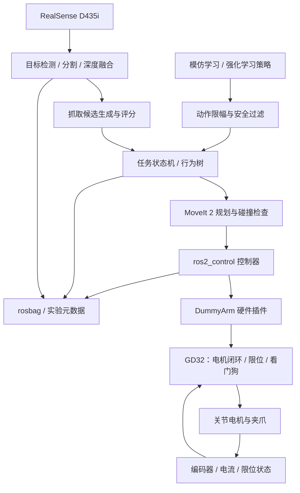

# DummyArm-ROS2-Grasp 项目蓝图

> 目标：把 dummy 机械臂建设成一个可复用的 ROS 2 操作、RGB-D 视觉抓取、模仿学习和强化学习实验平台。第一阶段以“桌面目标检测并稳定抓取到指定位置”为唯一主线，后续再扩展柑橘采摘和移动操作。

## 1. 项目边界与关键原则

### 1.1 第一版成功标准

第一版不是“训练出端到端智能体”，而是完成一个可测量、可复现的经典机器人闭环：

1. D435i 输出对齐后的彩色图和深度图。
2. 系统检测桌面目标并计算其相对机器人基座的 3D 位姿。
3. MoveIt 2 生成无碰撞轨迹。
4. `ros2_control` 向机械臂发送关节轨迹。
5. 夹爪完成抓取，将目标放到固定区域。
6. rosbag 记录传感器、状态、规划结果和任务结果。

建议首个验收场景使用尺寸、摩擦和形状稳定的方块或 3D 打印假果，不直接从枝叶遮挡的真实柑橘开始。

### 1.2 系统设计原则

- **硬实时下沉**：电机闭环、限位、急停、看门狗由 GD32 或现有电机驱动器负责，Linux 不承担硬实时安全职责。
- **标准接口优先**：机械臂统一暴露为 `ros2_control` 的 `SystemInterface`，规划统一走 MoveIt 2，学习策略不能直接绕过安全控制层。
- **先经典后学习**：先用几何方法和状态机打通抓取，再逐步让学习模型替换感知、抓取排序或轨迹残差模块。
- **仿真与真机同接口**：URDF、控制器名称、规划组和任务接口一致，只替换硬件插件与传感器源。
- **数据从第一天开始记录**：所有实验有配置、版本、随机种子、rosbag 和结果标签。
- **移动操作后置**：W4D 小车在桌面机械臂稳定后接入，避免同时调试底盘、机械臂、视觉和导航。

## 2. 总体架构



### 2.1 分层职责

| 层 | 主要职责 | 不应承担的职责 |
|---|---|---|
| MCU 固件 | 电机闭环、编码器、限位、急停、看门狗、故障码 | 路径规划、视觉、学习策略 |
| `ros2_control` | 硬件抽象、关节状态、轨迹控制器适配 | 目标检测、业务流程 |
| MoveIt 2 | IK、碰撞模型、运动规划、轨迹执行 | 电机协议、目标识别 |
| 感知 | 图像同步、检测/分割、深度融合、目标位姿 | 关节控制 |
| 抓取规划 | 抓取候选、可达性检查、候选评分 | 直接发电机命令 |
| 任务层 | pick/place 状态机、恢复、超时、重试 | 硬实时保护 |
| 学习层 | 策略训练、推理、评估、模型版本管理 | 绕过安全限制直接控制硬件 |

## 3. 硬件分工建议

### 3.1 QCS8550 FV04

定位为最终真机的边缘主机：

- 运行 ROS 2 Humble 节点、MoveIt 2 执行侧、任务层和视觉推理。
- 连接 D435i、机械臂控制板和后期的 W4D 底盘。
- 感知模型先使用 ONNX Runtime 验证，再根据系统镜像和 SDK 条件迁移到 Qualcomm QNN/SNPE。
- 保留 CPU 推理后备路径，避免加速器适配阻塞整条抓取链路。

需要尽早确认：板卡操作系统、内核、aarch64 用户态、USB 3 支持、RealSense SDK 可用性、QNN/SNPE 版本和 ROS 2 安装方式。

### 3.2 GD32

定位为机械臂实时控制器：

- 每轴位置/速度/电流采集与闭环控制。
- 限位开关、急停、过流、过温和通信超时保护。
- 维护单调递增时间戳、设备状态和故障码。
- 与主机采用 USB CDC、UART、CAN 或以太网中的一种稳定链路。

第一版建议协议使用定长二进制帧加 CRC，频率目标为：状态反馈 100–250 Hz，命令 100 Hz，心跳 10 Hz。若现有执行器本身已带闭环，GD32 主要负责总线管理、安全和状态汇总。

### 3.3 ESP32

不放在主控制链路中，可承担：

- 无线遥控、示教按钮、状态灯和蜂鸣器。
- 辅助传感器采集。
- 开发阶段的调试面板。

无线网络抖动不适合承担机械臂关节硬实时控制。

### 3.4 BPi-F3

作为可选的 RISC-V 适配与边缘节点实验平台，不进入 MVP 关键路径。可以在系统稳定后用于：

- ROS 2 跨架构兼容性测试。
- 独立传感器网关。
- 低功耗任务节点或日志节点。

### 3.5 Mac 与 Ubuntu 22.04 虚拟机

- Mac：代码管理、文档、数据检查、标注与轻量模型开发。
- Ubuntu 22.04 VM：ROS 2 Humble 构建、接口开发、单元测试、RViz 和轻量仿真。
- 重型仿真和训练：优先使用带 NVIDIA GPU 的原生 Ubuntu 主机或云端 GPU。虚拟机的 USB 直通和 GPU 加速可用于早期验证，但不应成为长期训练基础设施。

### 3.6 RealSense D435i

第一阶段推荐固定在外部支架上做 **eye-to-hand**：标定和排障更容易。机械臂闭环稳定后，再尝试末端相机 **eye-in-hand**。

注意事项：

- 提前确认工作距离满足 D435i 的有效深度范围。
- 固定曝光、分辨率和帧率，保存相机内参。
- 使用硬质安装支架，避免手眼标定后相机位姿变化。
- 彩色与深度对齐后再进行 2D 到 3D 反投影。

### 3.7 W4D 智能小车

第二阶段作为移动底座接入：

- 底盘提供 `/cmd_vel`、里程计、TF 和急停接口。
- 使用 Nav2 完成移动，机械臂工作时底盘锁止。
- 初期采用“移动到位—锁止—抓取”的串行流程，不做边移动边抓取。

## 4. ROS 2 工作空间与包结构

建议采用单仓库、一个主工作空间：

```text
dummyarm_ros2_grasp/
├── README.md
├── docs/
├── config/
├── datasets/              # 仅放索引和说明，大数据不直接提交 Git
├── models/                # 仅放模型清单，小权重可选
├── scripts/
└── src/
    ├── dummyarm_description/
    ├── dummyarm_hardware/
    ├── dummyarm_bringup/
    ├── dummyarm_moveit_config/
    ├── dummyarm_interfaces/
    ├── dummyarm_perception/
    ├── dummyarm_grasp_planner/
    ├── dummyarm_task/
    ├── dummyarm_calibration/
    ├── dummyarm_sim/
    ├── dummyarm_data/
    ├── dummyarm_learning/
    └── dummyarm_w4d_integration/
```

### 4.1 包职责

| 包 | 建议语言 | 内容 |
|---|---|---|
| `dummyarm_description` | XML/CMake | URDF/Xacro、网格、惯量、碰撞模型、ros2_control 标签 |
| `dummyarm_hardware` | C++ | `hardware_interface::SystemInterface`、串口/CAN 协议、诊断 |
| `dummyarm_bringup` | Python/XML/YAML | 控制器、相机、TF、MoveIt、任务层的统一 launch |
| `dummyarm_moveit_config` | 配置 | SRDF、规划组、运动学、控制器映射、碰撞参数 |
| `dummyarm_interfaces` | msg/srv/action | 跨包稳定接口；只定义确有必要的自定义消息 |
| `dummyarm_perception` | C++/Python | RGB-D 同步、检测/分割、点云过滤、目标 6D/3D 位姿 |
| `dummyarm_grasp_planner` | C++/Python | 几何抓取候选、可达性检查、评分与排序 |
| `dummyarm_task` | C++/Python | pick/place 状态机或 BehaviorTree.CPP、异常恢复 |
| `dummyarm_calibration` | Python/C++ | 相机内参、手眼标定、TCP、关节零位标定 |
| `dummyarm_sim` | C++/配置 | Gazebo 世界、控制插件、传感器、测试场景、域随机化 |
| `dummyarm_data` | Python | rosbag 录制配置、数据导出、数据集清单、实验元数据 |
| `dummyarm_learning` | Python | 模仿学习/RL 训练、评估、ONNX 导出、策略 ROS 节点 |
| `dummyarm_w4d_integration` | C++/配置 | 底盘接口、Nav2 参数、移动操作协调；后期启用 |

### 4.2 首批稳定接口

优先复用标准接口：

- `/joint_states`：`sensor_msgs/msg/JointState`
- `/joint_trajectory_controller/follow_joint_trajectory`：`control_msgs/action/FollowJointTrajectory`
- 相机：`sensor_msgs/msg/Image`、`CameraInfo`、`PointCloud2`
- TF：`map → odom → base_link → ... → tool0`，固定相机增加 `base_link → camera_link`
- 诊断：`diagnostic_msgs/msg/DiagnosticArray`
- 场景：MoveIt Planning Scene

建议自定义两个高层接口即可：

```text
PlanGrasp.action
  goal: object_id, preferred_tool, constraints
  result: ranked grasp candidates, failure_reason

PickPlace.action
  goal: object_id, target_pose, retry_limit
  feedback: current_stage, attempt, diagnostic
  result: success, final_error, metrics
```

低层电机协议不要直接暴露为业务节点话题；它应封装在 `dummyarm_hardware` 内部。

### 4.3 TF 与坐标系约定

从第一天固定 REP-103 习惯：米、弧度、右手系，X 前、Y 左、Z 上。建议至少包含：

```text
world
└── base_link
    ├── shoulder_link ... wrist_link ── tool0 ── tcp
    └── camera_link ── camera_color_optical_frame
```

所有检测结果都保留原始 `frame_id` 和时间戳，通过 TF 转换到 `base_link`；禁止把标定矩阵散落硬编码在多个节点中。

## 5. 仿真训练路线

### 5.1 仿真栈选择

ROS 2 Humble 主线建议：

- Gazebo Fortress + `ros_gz`/`gz_ros2_control`：用于传感器、碰撞、MoveIt 2 和任务链路集成。
- MoveIt 2 FakeSystem：用于最早期 URDF、规划组和轨迹接口验证。
- 后期学习训练可选 Isaac Lab 或 MuJoCo：用于高吞吐并行训练；通过统一 observation/action 定义与 ROS 2 真机侧对接。

不要一开始同时维护 Gazebo、Isaac 和 MuJoCo 三套资产。先让 URDF/Xacro 成为源模型，Gazebo 跑通后再编写转换和一致性测试。

### 5.2 四层仿真成熟度

1. **运动学仿真**：FakeSystem，验证关节方向、零位、限位、IK 和轨迹。
2. **动力学仿真**：Gazebo，补齐质量、惯量、摩擦、碰撞和控制增益。
3. **感知仿真**：虚拟 RGB-D、遮挡、噪声、桌面和目标随机化。
4. **学习仿真**：并行环境、域随机化、策略评估和 sim-to-real 测试。

### 5.3 模仿学习路线

模仿学习应在经典抓取闭环和数据采集链路稳定后开始：

1. 使用 MoveIt 2、手柄、键盘或 6D 鼠标完成示教。
2. 记录 RGB、深度、关节状态、TCP 位姿、夹爪状态、动作、阶段标签和成功标记。
3. 先训练行为克隆基线，输入为目标裁剪图/深度和机器人状态，输出为末端增量或离散技能。
4. 再尝试 ACT、Diffusion Policy 等序列策略。
5. 策略只输出有限范围的 TCP 增量或技能参数，由 MoveIt Servo/控制屏障进行限幅、碰撞检查和急停保护。

建议不要让第一版策略直接输出每个电机的电流或 PWM。

### 5.4 强化学习路线

RL 更适合作为局部能力增强，而不是替代整条系统：

- 抓取候选评分。
- 接近阶段的末端位姿残差修正。
- 夹爪闭合时机和力度参数。
- 遮挡情况下的主动观察位姿选择。

训练顺序：

1. 固定目标、无视觉噪声、短时域奖励。
2. 随机目标位姿和动力学参数。
3. 加入相机噪声、延迟、摩擦和质量随机化。
4. 与经典控制器组合，做 residual policy。
5. 真机只做小范围微调或离线强化学习，并设置动作边界。

核心指标包括成功率、碰撞率、平均完成时间、规划失败率、抓取滑落率和最大关节误差。

## 6. 真机部署路线

### 6.1 部署拓扑

第一版推荐单机 ROS 图：QCS8550 运行全部真机节点，GD32 作为非 ROS 的实时从控。开发机通过局域网查看 RViz、日志和诊断。

网络配置建议：

- 固定 ROS Domain ID。
- 对高带宽图像话题使用 Best Effort；对命令、任务结果和诊断使用 Reliable。
- 图像只在需要的节点间传递，尽量使用组合节点或进程内通信。
- 远程开发机不稳定时，真机任务仍能安全停止。

### 6.2 启动分级

建议提供四个 bringup 模式：

```text
description.launch.py   # 只显示模型与 TF
control.launch.py       # 机械臂硬件、控制器、诊断
perception.launch.py    # 相机、标定 TF、感知
pick_place.launch.py    # 全系统任务
```

每一级都能独立验收，出现问题时不必启动整套系统。

### 6.3 安全链路

真机前必须具备：

- 物理急停，直接切断执行器使能。
- 软件急停与控制器生命周期管理。
- MCU 通信超时后自动停机。
- 关节位置、速度、电流/力矩和工作空间限制。
- 上电不自动运动；使能、回零、运行是不同状态。
- 故障恢复前明确清除原因，不自动无限重试。
- 首次运动使用低速、低加速度、无负载和大空间。

## 7. 柑橘数据与视觉路线

现有约 14,000 张图像很有价值，但首先要做数据审计：

- 图像来源、分辨率、场景、光照、品种和拍摄距离。
- 是否存在框、掩码、果梗、枝条、遮挡等级或成熟度标注。
- 训练/验证/测试是否按果园、视频序列或采集批次隔离，避免相邻帧泄漏。
- 是否含相机内参、深度、机械臂状态和抓取结果。

若只有 RGB 图像，它们适合训练检测/实例分割，但不能单独训练完整 3D 抓取策略。建议分三步使用：

1. 训练柑橘检测或实例分割基线。
2. 在真机上用 D435i 将掩码与深度融合，估计果实中心、尺寸和表面法向。
3. 新采集 RGB-D + 机器人状态 + 抓取结果，构建真正的抓取数据集。

采摘末端工具会显著改变规划。若目标是从枝条采摘，需尽早确定夹持、吸附、旋拧还是剪切方案；MVP 先做“散放柑橘抓取与搬运”，再增加果梗检测和剪切动作。

## 8. 开发里程碑与验收门槛

| 里程碑 | 预计时间 | 主要产物 | 验收门槛 |
|---|---:|---|---|
| M0 规格冻结 | 1–2 周 | 关节表、通信协议、坐标系、安全需求、仓库骨架 | 每个关节的方向、零位、限位、减速比、反馈方式明确 |
| M1 数字样机 | 2 周 | URDF/Xacro、RViz、MoveIt 配置 | 模型无 TF 错误，规划组可完成典型位姿规划 |
| M2 关节控制 | 2–4 周 | GD32 固件、硬件插件、控制器配置 | 低速轨迹重复执行，急停和超时保护有效 |
| M3 仿真抓取 | 2–3 周 | Gazebo 场景、抓取状态机 | 随机桌面目标 50 次成功率不低于 80% |
| M4 RGB-D 感知 | 2–4 周 | 相机标定、目标检测、3D 定位 | 静态目标位置误差满足夹爪容差，连续运行无明显漂移 |
| M5 真机闭环 | 3–5 周 | 全系统 bringup、恢复策略、数据记录 | 100 次桌面抓取统计成功率、碰撞率与耗时 |
| M6 柑橘感知 | 3–5 周 | 数据审计、分割模型、RGB-D 融合 | 独立测试集指标明确，真机场景可输出稳定 3D 目标 |
| M7 模仿学习 | 4–8 周 | 示教数据、BC/ACT/Diffusion 基线 | 在固定任务上超过或补充经典基线，并可安全回退 |
| M8 强化学习 | 6–10 周 | 并行仿真、域随机化、残差策略 | 仿真收益稳定，真机不突破安全边界，A/B 指标有提升 |
| M9 移动操作 | 4–8 周 | W4D/Nav2 集成、停靠和锁止 | 底盘到位后完成抓取，移动与机械臂安全互锁 |

时间可并行，但验收门槛不应跳过。若每周可投入时间有限，应以里程碑通过为准，不以日历日期为准。

## 9. M0 必须收集的机械臂参数

开始写 URDF 和硬件插件前，需要建立一张关节清单：

| 字段 | 示例 |
|---|---|
| 关节名称与自由度 | `joint_1`，旋转 |
| 电机与驱动器 | 型号、额定电流、控制模式 |
| 传动 | 减速比、丝杆导程、齿数 |
| 编码器 | 分辨率、绝对/增量、安装侧 |
| 机械限位 | 最小/最大角、物理限位开关 |
| 运动限制 | 最大速度、加速度、jerk |
| 正方向 | 电机正转对应的关节正方向 |
| 零位 | 机械零位、编码器零位、回零方法 |
| 几何 | 相邻关节轴、原点、连杆尺寸 |
| 动力学 | 质量、质心、惯量；可后续精化 |
| 安全 | 过流、堵转、通信超时行为 |

还需要确认夹爪类型、最大开口、是否有位置/电流反馈、TCP 定义，以及机械臂实际自由度。

## 10. 推荐的首个 14 天冲刺

### 第 1–3 天：规格与安全

- 拍摄各关节和控制板，整理型号与接线。
- 测量连杆尺寸、关节轴方向、角度范围和夹爪尺寸。
- 确定主机到 GD32 的物理链路。
- 建立物理急停、上电和回零流程。

### 第 4–7 天：数字模型

- 创建 `dummyarm_description`。
- 用简化几何体完成 Xacro，不等待精细 CAD。
- 在 RViz 检查关节方向、零位、限位和 TF。
- 生成第一版 MoveIt 2 配置，使用 FakeSystem 规划。

### 第 8–11 天：控制接口

- 冻结主机—MCU 协议 v0.1。
- 实现硬件插件骨架和模拟串口后端。
- 启动 `joint_state_broadcaster` 和 `joint_trajectory_controller`。
- 编写通信断开、CRC 错误和超限测试。

### 第 12–14 天：最小集成

- 启动 MoveIt 2 → 轨迹控制器 → 模拟硬件闭环。
- 记录 rosbag 与诊断。
- 形成 M0/M1 验收报告，并列出所有未确认硬件参数。

## 11. 首批决策建议

1. **相机布置**：先 eye-to-hand，后 eye-in-hand。
2. **控制架构**：GD32 实时闭环，QCS8550 运行 ROS 2 与推理。
3. **软件主线**：ROS 2 Humble + ros2_control + MoveIt 2 + Gazebo Fortress。
4. **第一目标**：桌面 3D 打印物体 pick-and-place，不直接挑战枝叶遮挡采摘。
5. **学习切入点**：先感知和抓取评分，再做末端增量策略，不做裸电机端到端控制。
6. **W4D 接入**：放到固定机械臂抓取稳定之后。
7. **数据策略**：14,000 张图像用于视觉基线；另采 RGB-D、机器人状态和成功标签用于抓取学习。

## 12. 下一步输入清单

为了把蓝图转成可编译的 ROS 2 仓库，下一步需要以下信息：

1. dummy 机械臂自由度、关节类型和照片/结构图。
2. 每个电机、驱动器、编码器和减速机构型号。
3. 当前控制方式与已有固件/上位机协议。
4. 夹爪或计划使用的采摘末端工具。
5. QCS8550 当前系统镜像和可用接口。
6. 14,000 张柑橘图像的目录结构、标注格式和若干样例。
7. 是否有可用 NVIDIA GPU 主机，以及希望优先完成仿真还是真机运动。

拿到第 1–4 项后即可创建真实 URDF、控制协议和 `ros2_control` 硬件插件；拿到第 6 项后可以并行启动数据审计与视觉基线。
