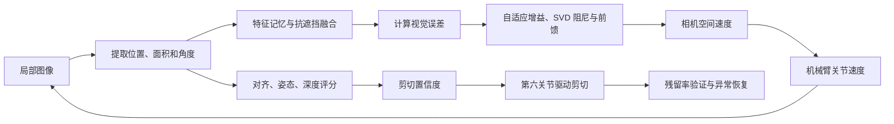

# 发明专利控制方法的公式与专业术语详解

> 对应专利：一种基于双视协同与视觉伺服的柑橘无损采摘机器人的控制方法  
> 阅读目标：理解每个公式输入什么、输出什么、为什么有效，以及公式最终怎样转化为机械臂动作。

## 一、先理解公式在控制链中的位置

全部公式可以分成三组：

1. **跟踪与运动控制公式**：回答“怎样让末端稳定地跟随并对准果梗”；
2. **剪切决策公式**：回答“什么时候具备安全剪切条件”；
3. **结果验证公式**：回答“剪切是否成功，失败后怎样处理”。

## 二、视觉特征与基础关系

### 1. 视觉特征向量

交底书将果梗特征写为：

$$
\mathbf{s}=[u,\ v,\ \ln(A_{img}),\ \theta]^T
$$

各变量含义如下：

| 符号 | 专业名称 | 含义 | 在控制中的作用 |
|---|---|---|---|
| $u,v$ | 图像坐标、像素坐标 | 果梗中心在图像平面中的横、纵位置 | 判断目标相对套筒中心偏向哪一侧 |
| $A_{img}$ | 图像特征面积 | 果梗分割掩码的有效像素面积 | 间接反映目标尺度和相机与目标的相对距离 |
| $\ln(A_{img})$ | 对数尺度特征 | 对面积取自然对数 | 压缩数值范围，使尺度变化更平滑 |
| $\theta$ | 主轴倾斜角 | 由分割区域的主方向估计果梗朝向 | 用于调整刀片与果梗的相对角度 |
| $T$ | 转置 | 将行向量写成列向量 | 便于矩阵运算 |

### 2. 期望特征与视觉误差

视觉伺服需要预先定义期望特征 $\mathbf{s}^{*}$，它代表果梗已经处于理想剪切位姿时的图像状态。通常可写为：

$$
\mathbf{e}=\mathbf{s}-\mathbf{s}^{*}
$$

其中 $\mathbf{e}$ 是视觉误差。若 $\mathbf{e}=0$，说明当前图像特征已经与期望状态重合；只要 $\mathbf{e}\neq0$，控制器就继续产生修正运动。

### 3. 图像雅可比矩阵

图像雅可比矩阵也称**交互矩阵**，一般关系为：

$$
\dot{\mathbf{s}}=\mathbf{J}_{img}\mathbf{V}_{cam}
$$

其中：

- $\dot{\mathbf{s}}$ 表示图像特征随时间的变化速度；
- $\mathbf{V}_{cam}$ 表示相机的空间速度，通常包含三个平移速度和三个转动速度；
- $\mathbf{J}_{img}$ 描述“相机怎样运动会使图像特征怎样变化”。

这条关系是“图像误差能够驱动机械臂”的数学桥梁。控制器先规定图像特征应该怎样变化，再利用雅可比矩阵的逆关系求出相机应该怎样运动。

## 三、特征记忆衰减与抗遮挡公式

### 1. 原始公式

$$
\mathbf{s}_{t}
=\rho\,\mathbf{s}_{visual}
+(1-\rho)\left(\mathbf{s}_{t-1}+\dot{\mathbf{s}}_{t-1}\Delta t\right)
$$

### 2. 专业术语解释

| 术语或符号 | 解释 |
|---|---|
| $\rho\in[0,1]$ | 遮挡置信度，根据分割掩码完整度等指标计算；越接近 1，说明当前观测越可靠 |
| $\mathbf{s}_{visual}$ | 当前帧由视觉模型直接测得的特征 |
| $\mathbf{s}_{t-1}$ | 上一控制周期保存的特征状态 |
| $\dot{\mathbf{s}}_{t-1}$ | 上一周期估计的特征变化率 |
| $\Delta t$ | 相邻控制周期的时间间隔，即采样周期 |
| 一阶外推 | 根据“当前位置 + 当前速度 × 时间”预测下一时刻位置 |
| 置信度加权融合 | 按可信程度在实时观测和历史预测之间进行加权，形式上类似互补滤波 |

### 3. 为什么该公式可以抗短时遮挡

公式右侧包含两个候选结果：

- 当前视觉观测：$\mathbf{s}_{visual}$；
- 历史运动预测：$\mathbf{s}_{t-1}+\dot{\mathbf{s}}_{t-1}\Delta t$。

$\rho$ 和 $1-\rho$ 的和始终为 1，因此这是两个结果的凸组合：

- 画面清晰时，$\rho\rightarrow1$，输出主要由当前图像决定；
- 枝叶遮挡时，$\rho\rightarrow0$，输出主要由历史状态和运动趋势决定；
- 部分遮挡时，系统在两者之间平滑过渡。

如果没有这一步，目标检测在“检测到”和“未检测到”之间跳变，可能直接造成速度指令突变。加权融合使输入控制器的特征保持连续，从而减少机械臂突然加速或转向。

### 4. 适用边界

该公式适合处理**短时间遮挡**。如果目标长时间被遮挡，恒速外推误差会不断累积，因此还需要设置最大预测时长；超过时限后应减速、停止、退回全局视觉或重新寻找目标。

## 四、视觉深度尺度耦合的自适应增益

### 1. 原始公式

$$
\lambda(\mathbf{e},A_{img})
=\lambda_{min}+(\lambda_{max}-\lambda_{min})
\left[
1-\exp\left(-\alpha\lVert\mathbf{e}\rVert
\sqrt{\frac{A_{img}}{A_{ref}}}\right)
\right]
$$

### 2. 专业术语解释

| 符号 | 解释 |
|---|---|
| $\lambda$ | 视觉伺服增益，决定误差被转换成多大的修正速度 |
| $\lambda_{min},\lambda_{max}$ | 允许的最小和最大控制增益 |
| $\alpha$ | 增益曲线的斜率参数，越大则增益上升越快 |
| $\lVert\mathbf{e}\rVert$ | 视觉误差的欧氏范数，即多个误差分量合成为一个非负数 |
| $A_{img}$ | 当前目标图像面积 |
| $A_{ref}$ | 目标处于参考作业距离时的标定面积 |
| 尺度耦合 | 控制增益不仅取决于误差，还取决于目标在图像中的尺度 |
| 指数饱和函数 | $1-e^{-x}$，输入增大时输出逐渐接近 1，不会无限增长 |

### 3. 为什么该公式可以调节运动强度

令

$$
x=\alpha\lVert\mathbf{e}\rVert\sqrt{\frac{A_{img}}{A_{ref}}}
$$

因为 $x\ge0$，所以 $1-e^{-x}$ 的取值位于 $[0,1)$ 内，进而保证：

$$
\lambda_{min}\le\lambda<\lambda_{max}
$$

这意味着控制增益始终受到上下限约束，不会无限放大。

- 目标较远时，$A_{img}/A_{ref}$ 较小，$x$ 较小，$\lambda$ 接近 $\lambda_{min}$，可避免机械臂对远处的像素抖动做出剧烈响应；
- 目标靠近且误差仍较大时，面积比和误差范数同时增大，$\lambda$ 向 $\lambda_{max}$ 上升，加快对准；
- 误差逐渐接近零时，$\lambda$ 又趋向 $\lambda_{min}$，使末段运动更平缓，减少越过目标后反复振荡。

因此，该公式的实际效果更准确地概括为：**远处限制动作，近处有明显偏差时加强修正，接近零误差时平稳收敛。**

### 4. 公式校核提示

交底书公式中采用的是面积比的**平方根** $\sqrt{A_{img}/A_{ref}}$，不是正文所写的“面积比值项的平方”。答辩、论文和后续专利文本应统一表述。

## 五、基于 SVD 的平滑动态阻尼

### 1. 奇异值分解

$$
\mathbf{J}_{img}=\mathbf{U}\mathbf{\Sigma}\mathbf{V}^{T}
$$

**奇异值分解（Singular Value Decomposition，SVD）**把一个复杂矩阵分解为若干相互正交的运动方向及各方向上的缩放系数。$\mathbf{\Sigma}$ 对角线上的 $\sigma_i$ 称为奇异值。

若最小奇异值 $\sigma_{min}$ 接近零，说明至少存在一个方向：图像希望发生明显变化，却需要机械臂产生很大的速度才能实现。直接求逆时会出现近似 $1/\sigma_{min}$ 的放大，容易造成关节速度突增。

### 2. 动态阻尼公式

$$
\mu^2(\sigma_{min})=
\begin{cases}
0, & \sigma_{min}\ge\sigma_{th}\\[4pt]
\mu_{max}^{2}\left(1-\left(\dfrac{\sigma_{min}}{\sigma_{th}}\right)^2\right)^2,
& \sigma_{min}<\sigma_{th}
\end{cases}
$$

### 3. 专业术语解释

| 符号或术语 | 解释 |
|---|---|
| $\sigma_{min}$ | 当前图像雅可比矩阵的最小奇异值 |
| $\sigma_{th}$ | 安全阈值；低于该值时认为开始接近奇异区域 |
| $\mu^2$ | 正则化阻尼项，用于限制逆运算对小奇异值的放大 |
| $\mu_{max}^2$ | 最大阻尼强度 |
| 奇异位形 | 某些运动方向上的自由度退化，普通逆解可能要求极大的关节速度 |
| 正则化 | 在病态逆问题中加入约束，以少量精度损失换取数值稳定性 |
| $C^1$ 连续 | 函数值及其一阶导数都连续，控制量不会在阈值处突然跳变 |
| Jerk | 加加速度，即加速度对时间的变化率；过大会造成机械冲击和抖动 |

### 4. 为什么该阻尼可以避免速度爆炸

- 当 $\sigma_{min}\ge\sigma_{th}$ 时，系统处于相对安全区域，阻尼为零，不额外牺牲响应能力；
- 当 $\sigma_{min}<\sigma_{th}$ 时，越接近零，阻尼越接近 $\mu_{max}^2$，逆解中的危险放大就越受抑制；
- 当 $\sigma_{min}=\sigma_{th}$ 时，阻尼函数值为零，而且从阈值左侧趋近时一阶导数也为零，与右侧常数零平滑连接，因此不会在进入阻尼区的一瞬间产生控制突变。

这里使用平方后的高阶曲线，目的不是让阻尼简单地“开或关”，而是让阻尼随着奇异程度连续增加。

## 六、速度指令与目标运动前馈

### 1. 交底书公式

$$
\mathbf{V}_{cam}
=\sum_{i=1}^{n}
\frac{\sigma_i}{\sigma_i^2+\mu^2(\sigma_{min})}
\mathbf{u}_i\mathbf{v}_i^T
\left(
-\lambda(\mathbf{e},A_{img})\mathbf{e}
+\Gamma\dot{\hat{\mathbf{s}}}_{target}
\right)
$$

### 2. 各部分分别做什么

#### 负反馈项

$$
-\lambda\mathbf{e}
$$

假设误差定义为 $\mathbf{e}=\mathbf{s}-\mathbf{s}^{*}$，前面的负号会使系统沿减小误差的方向运动。偏差越大，修正要求越强；误差趋近零时，反馈项也趋近零。这就是闭环稳定对准的核心。

#### 前馈项

$$
\Gamma\dot{\hat{\mathbf{s}}}_{target}
$$

| 符号或术语 | 解释 |
|---|---|
| $\dot{\hat{\mathbf{s}}}_{target}$ | 估计的目标图像特征变化率，即果梗在画面中的运动趋势 |
| $\Gamma$ | 前馈补偿系数，决定采用多少预测量 |
| 反馈 | 看到已经发生的误差后再纠正 |
| 前馈 | 根据目标变化趋势提前产生补偿 |

仅依靠反馈时，系统必须先看到目标已经移动，才会开始追赶；加入前馈后，可以利用连续帧估计目标下一时刻的位置，部分抵消相机采样、图像推理和通信带来的延迟。

#### 带阻尼的奇异方向增益

$$
\frac{\sigma_i}{\sigma_i^2+\mu^2}
$$

- 若系统远离奇异区，$\mu=0$，该项等于 $1/\sigma_i$，接近普通伪逆；
- 若某个奇异值很小且阻尼已经增大，分母不会趋近零，因此速度不会无限放大；
- 较大的奇异值受同一阻尼的相对影响较小，所以正常方向上的控制能力被较多保留。

### 3. 从相机速度到关节速度

上述公式输出的是相机坐标系下的空间速度 $\mathbf{V}_{cam}$，并不能直接发送给各关节电机。工程实现中还需要：

1. 根据手眼标定结果，将相机速度变换到末端或机器人基坐标系；
2. 使用机械臂雅可比矩阵，把末端空间速度转换为关节速度 $\dot{\mathbf{q}}$；
3. 对关节速度、加速度、工作空间和碰撞风险设置限幅；
4. 将安全处理后的指令发送给下位机闭环执行。

于是控制链为：

$$
\text{图像误差}
\rightarrow \text{期望图像变化}
\rightarrow \mathbf{V}_{cam}
\rightarrow \text{末端速度}
\rightarrow \dot{\mathbf{q}}
\rightarrow \text{关节运动}
$$

### 4. 维度校核提示

若严格采用 $\mathbf{J}_{img}=\mathbf{U}\mathbf{\Sigma}\mathbf{V}^{T}$ 的常规定义，则阻尼伪逆通常展开为：

$$
\mathbf{J}_{img}^{\dagger}
=\sum_i\frac{\sigma_i}{\sigma_i^2+\mu^2}
\mathbf{v}_i\mathbf{u}_i^T
$$

交底书公式写成了 $\mathbf{u}_i\mathbf{v}_i^T$。二者顺序不同，可能造成矩阵维度不匹配。后续论文、专利定稿或程序实现时，应结合 $\mathbf{J}_{img}$ 的实际维度与映射方向核对；如果沿用常规 SVD 定义，建议改为 $\mathbf{v}_i\mathbf{u}_i^T$。

## 七、空间对齐度公式

### 1. 原始公式

$$
S_{align}
=\exp\left[
-\left(
\frac{(u_t-u_c)^2}{2\sigma_u^2}
+\frac{(v_t-v_c)^2}{2\sigma_v^2}
\right)
\right]
$$

### 2. 专业术语解释

| 符号 | 解释 |
|---|---|
| $(u_t,v_t)$ | 当前果梗中心坐标 |
| $(u_c,v_c)$ | 末端套筒或剪切区域的基准中心坐标 |
| $\sigma_u,\sigma_v$ | 水平和垂直方向的容差尺度，应由套筒开口尺寸、相机标定和安全余量确定 |
| 高斯衰减 | 偏差平方进入指数函数，偏差增大时得分快速下降 |
| 各向异性 | 水平和垂直方向可以设置不同容差，以匹配非圆形有效区域 |

### 3. 为什么能判断是否对准

当果梗中心与套筒中心完全重合时，两个偏差都为零，因此 $S_{align}=1$。随着任一方向偏差增大，指数中的负数绝对值增大，评分迅速趋近零。

例如，若只有水平方向存在一个标准差的偏差，即 $|u_t-u_c|=\sigma_u$，则对应得分约为 $e^{-1/2}\approx0.607$；偏差达到两个标准差时，得分约为 $e^{-2}\approx0.135$。因此，该函数会明显惩罚偏心状态。

高斯函数本身是连续的“软约束”，并不是绝对硬边界；后续阶跃函数 $H(S_{align}-S_{safe})$ 才承担空间安全底线的硬否决作用。

## 八、姿态匹配度公式

### 1. 原始公式

$$
S_{pose}
=\left|\cos(\theta_{target}-\theta_{ref})\right|^{k}
$$

### 2. 专业术语解释

| 符号 | 解释 |
|---|---|
| $\theta_{target}$ | 当前果梗主轴角度 |
| $\theta_{ref}$ | 刀片最佳切入姿态对应的参考角度 |
| $k$ | 姿态敏感度指数；越大，对角度偏差越严格 |
| 主轴 | 对分割区域进行几何分析得到的主要延伸方向 |

### 3. 为什么能判断姿态是否合适

当两者方向一致时，角度差为零，$|\cos 0|^k=1$。当角度差趋近 $90^\circ$ 时，得分趋近零。指数 $k$ 会进一步压低非理想角度的得分：例如角度差为 $30^\circ$ 时，基础余弦约为 0.866；当 $k=4$ 时，得分约为 0.563，使控制器对偏斜更敏感。

绝对值使相差 $180^\circ$ 的两条轴线也得到相同评分。这对果梗“主轴”是合理的，因为图像主轴通常只有方向线而没有正反端点，即角度以 $180^\circ$ 为周期。

## 九、深度逼近度公式

### 1. 原始公式

$$
S_{depth}
=\frac{1}
{1+\exp\left[-\gamma\left(\dfrac{A_{cur}}{A_{trigger}}-1\right)\right]}
$$

### 2. 专业术语解释

| 符号或术语 | 解释 |
|---|---|
| $A_{cur}$ | 当前帧目标分割掩码的有效面积 |
| $A_{trigger}$ | 标定的基准面积 |
| $\gamma$ | Logistic 曲线陡度；越大，基准点附近的状态切换越陡 |
| Logistic 函数 | 将任意实数连续映射到 $(0,1)$ 的 S 型函数 |
| 单调映射 | 输入面积比越大，输出评分越高 |

### 3. 为什么能表示接近程度

同一目标在相机中通常会随着距离缩短而变大，因此面积比 $A_{cur}/A_{trigger}$ 可以作为接近程度的视觉代理量。Logistic 函数在远离基准面积时保持低分，在基准点附近快速上升，在很近时逐渐饱和，既能压低远距离噪声，又避免评分无限增大。

需要特别注意：当 $A_{cur}=A_{trigger}$ 时，指数项为零，因此：

$$
S_{depth}=\frac{1}{2}
$$

所以 $A_{trigger}$ 在该公式中严格来说是 Logistic 曲线的**中点面积**，并不是最终剪切置信度的直接触发点。若希望在该面积处获得其他评分，需要重新定义偏置项或结合总阈值标定。

若单独要求 $S_{depth}\ge p$，对应面积条件为：

$$
\frac{A_{cur}}{A_{trigger}}
\ge 1+\frac{1}{\gamma}\ln\frac{p}{1-p}
$$

例如希望 $S_{depth}\ge0.85$，则面积比至少需要达到 $1+1.735/\gamma$。

### 4. 适用边界

单目图像面积不能从根本上消除“远处的大果”和“近处的小果”具有相似像素面积的歧义。Logistic 函数只是把面积连续映射为置信度，并不会自动解决个体尺寸差异。工程实现中可通过以下方式增强可靠性：

- 针对同一品种和不同果径区间分别标定；
- 将果实直径、套筒边缘特征或 RGB-D 深度一并用于归一化；
- 结合连续帧面积增长率判断末端是否正在接近；
- 为深度判定设置合理容差，而不把面积作为唯一安全依据。

## 十、剪切置信度与“一票否决”机制

### 1. 原始公式

$$
C_{cut}
=(S_{align}S_{pose}S_{depth})
\times H(S_{align}-S_{safe})
$$

其中阶跃函数可定义为：

$$
H(x)=
\begin{cases}
1,&x\ge0\\
0,&x<0
\end{cases}
$$

### 2. 专业术语解释

| 术语或符号 | 解释 |
|---|---|
| 乘性融合 | 将多个 $[0,1]$ 评分相乘，任何短板都会明显降低总分 |
| $S_{safe}$ | 空间对齐安全底线 |
| 阶跃函数 $H$ | 产生 0 或 1 的硬开关 |
| 剪切使能 | 控制器允许第六关节执行剪切动作的逻辑信号 |
| 稳定时间窗口 | 条件必须连续满足一段时间，防止单帧误检触发动作 |

### 3. 为什么乘法比简单平均更安全

假设三个评分分别为 0.95、0.95 和 0.20：

- 若取算术平均，结果为 0.70，可能掩盖第三项的严重不足；
- 若采用乘法，总分仅为 $0.95\times0.95\times0.20\approx0.18$，短板会被明确暴露。

当 $S_{align}<S_{safe}$ 时，阶跃函数输出零，无论另外两项多高，最终 $C_{cut}$ 都为零。这才是严格意义上的空间对齐“一票否决”。

从数学上说，乘法本身不会使一个较低但非零的评分“立刻归零”；它是**软性短板效应**。乘性融合与总阈值 $T_{trigger}$ 共同形成近似一票否决，阶跃函数则为空间对齐提供真正的硬否决。答辩时这样解释更严谨。

### 4. 为什么还需要稳定时间窗口

系统只有在：

$$
C_{cut}\ge T_{trigger}
$$

并持续至少 $t_{stable}$ 后才允许剪切。这样可以过滤单帧分割误差、光照闪烁和风吹造成的瞬时高分。它相当于要求“条件不仅满足，而且稳定满足”。

## 十一、剪切后的特征残留率

### 1. 原始公式

$$
\eta_{residual}=\frac{A_{post}}{A_{pre}}
$$

其中 $A_{pre}$ 和 $A_{post}$ 分别为剪切前、剪切后图像中的果实有效像素面积。

### 2. 为什么采用比值而不是面积差

比值具有归一化作用。若只计算面积差，同样减少 1000 个像素，对大果和小果的意义并不相同；使用剪切后面积除以剪切前面积后，不同初始目标大小可以在相同尺度上比较。

- $\eta$ 接近 0：目标大部分从原位置消失，支持“已经脱落”的判断；
- $\eta$ 处于中间范围：目标仍部分可见，结合目标中心向下位移，可判断半悬挂；
- $\eta$ 接近 1：剪切前后变化很小，支持“剪切失败或卡滞”的判断。

交底书采用的状态区间为：

| 残留率条件 | 状态判断 | 控制动作 |
|---|---|---|
| $\eta\le0.15$ | 成功脱落 | 记录成功，选择下一目标 |
| $0.15<\eta<0.70$ | 可能半悬挂 | 结合向下位移，执行微距后撤并复测 |
| $\eta\ge0.70$ | 严重卡滞或剪切失败 | 二次补剪；超过次数后报警保护 |

这种处理方式属于**有限状态机（Finite-State Machine，FSM）**：系统根据可观测指标进入不同状态，每个状态对应明确动作和下一次转移条件。

### 3. 使用时应满足的条件

剪切前后图像应尽量保持相同视角和曝光，分割模型也要保持稳定；否则相机运动、亮度变化或遮挡可能被误认为果实面积变化。更稳妥的验证还可融合目标中心位移、深度变化、果梗连通性和末端电流等信息。

## 十二、常用专业术语速查表

| 专业术语 | 英文 | 通俗解释 |
|---|---|---|
| RGB-D 相机 | RGB-Depth Camera | 同时获得彩色图像和深度信息的相机 |
| 语义分割 | Semantic Segmentation | 判断每一个像素属于果梗、果实、枝叶或背景中的哪一类 |
| 掩码 | Mask | 模型分割出的目标像素区域 |
| 视觉伺服 | Visual Servoing | 直接利用连续图像反馈修正机器人运动 |
| 基于图像的视觉伺服 | Image-Based Visual Servoing, IBVS | 在图像特征空间中定义误差并产生运动指令 |
| 闭环控制 | Closed-Loop Control | 动作后继续测量结果，并根据新误差再次修正 |
| 开环控制 | Open-Loop Control | 根据初始测量执行动作，中途不再依据结果修正 |
| 逆运动学 | Inverse Kinematics | 根据期望末端位置和姿态求解各关节角度 |
| 雅可比矩阵 | Jacobian Matrix | 描述关节或相机速度与末端或图像特征速度之间的局部线性关系 |
| 伪逆 | Pseudoinverse | 对非方阵或不可逆矩阵求近似逆解的方法 |
| 奇异值分解 | Singular Value Decomposition, SVD | 将矩阵分解为若干独立方向及其缩放强度 |
| 奇异位形 | Singularity | 机器人在某些方向上运动能力退化、逆解可能异常放大的状态 |
| 阻尼最小二乘 | Damped Least Squares, DLS | 在逆解中加入阻尼，限制奇异区域的速度放大 |
| 正则化 | Regularization | 通过附加约束提高病态计算的稳定性 |
| 自适应增益 | Adaptive Gain | 根据误差或环境状态实时改变控制强度 |
| 前馈补偿 | Feedforward Compensation | 根据目标变化趋势提前补偿系统延迟 |
| 欧氏范数 | Euclidean Norm | 多维误差向量的综合长度，常写作 $\lVert\mathbf{e}\rVert$ |
| 高斯函数 | Gaussian Function | 在中心取得最大值，偏离中心后快速衰减的函数 |
| Logistic 函数 | Logistic Function | 将输入映射为 0 到 1 之间 S 型评分的函数 |
| 阶跃函数 | Step Function | 根据是否越过阈值输出 0 或 1 的硬开关 |
| 乘性融合 | Multiplicative Fusion | 多项评分相乘，使任何低分项都显著降低总分 |
| 稳定时间窗口 | Stability Time Window | 条件持续满足规定时间后才确认有效 |
| 有限状态机 | Finite-State Machine, FSM | 根据当前状态和观测条件选择下一动作的离散控制逻辑 |
| 手眼标定 | Hand–Eye Calibration | 标定相机坐标系与机械臂坐标系之间的空间关系 |
| 鲁棒性 | Robustness | 存在噪声、遮挡、扰动或模型误差时仍能稳定工作的能力 |
| 采样周期 | Sampling Period | 控制器相邻两次计算之间的时间间隔 |
| Jerk | Jerk | 加速度变化率，过大会引起冲击和机械抖动 |

## 十三、答辩时解释“公式为什么有用”的推荐顺序

1. 先说物理问题：目标会动、会被遮挡，机械臂还可能接近奇异位形；
2. 再说公式输入：位置、面积、角度、置信度和目标运动速度；
3. 解释关键函数形状：高斯函数惩罚偏心，余弦函数评价角度，Logistic 函数判断接近程度；
4. 解释负反馈：误差存在就产生相反方向的修正，误差减小则动作减小；
5. 解释安全机制：SVD 阻尼限制异常速度，乘性融合和阶跃函数限制误剪；
6. 最后强调闭环：剪切后仍要验证，失败会进入补剪或保护状态。

可用一句话收束：

> 这些公式分别把“看不清怎么办、怎样移动、什么时候能剪、剪完是否成功”转化为可计算的状态和控制量，再通过连续图像反馈不断修正机械臂，因此构成了从视觉感知到安全剪切的完整闭环。
