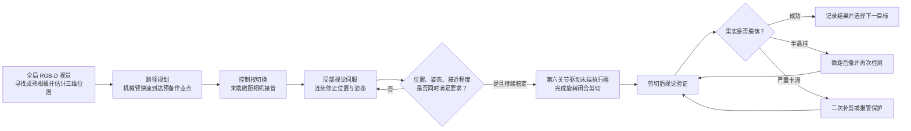

# 发明专利控制方法的整体逻辑、作用机理与创新性说明

> 专利名称：一种基于双视协同与视觉伺服的柑橘无损采摘机器人的控制方法  
> 申请号：2026106270647（规范书写时通常写作 202610627064.7）  
> 本文用途：中期报告“已取得的阶段性成果”部分及答辩口头讲解。

## 一、一句话说明该控制方法

该方法不是让机械臂根据全局相机测得的一个坐标直接完成采摘，而是先利用全局 RGB-D 相机寻找柑橘并快速接近，再由末端微距相机持续观察果梗、实时修正机械臂的位置和姿态，只有在位置、角度和接近程度同时满足要求时才允许剪切，剪切后还要通过图像确认果实是否真正脱落，并对未完全剪断或卡滞等情况进行补救。

其本质是把传统的“看一次、算坐标、直接剪”的开环作业，改造成“感知—接近—对准—剪切—验证—纠错”的全过程闭环作业。

## 二、为什么需要这种控制方法

传统采摘机器人通常通过远距离相机估计果实三维位置，然后根据该坐标规划机械臂运动。这种方式在结构化实验环境中可以工作，但在真实果园中存在三个突出问题：

1. 全局相机距离目标较远，深度测量、相机标定、坐标转换和机械臂运动误差会逐级累积，末端到达果实附近时仍可能存在厘米级偏差。
2. 果实和枝条会受到自然风或机械臂碰触的影响而移动，机械臂若仍执行最初规划的轨迹，就可能抓空或剪偏。
3. 仅知道果实中心位置并不足以安全剪切，还必须使果梗进入末端执行器的有效剪切区域，并使刀片与果梗保持合适的相对姿态。

因此，该专利不把全局定位结果当成最终答案，而只将其作为“快速接近目标”的依据；真正决定末端精确运动和剪切时机的是近距离局部视觉反馈。

## 三、控制方法的总体结构

整个系统可以理解为两个空间尺度、三个控制阶段和一个结果反馈环节：

- **大范围感知层**：全局 RGB-D 相机解决“目标在哪里”。
- **近距离控制层**：末端微距相机解决“是否真正对准”。
- **动作决策层**：多特征判定解决“现在能不能剪”。
- **结果验证层**：剪切后图像解决“到底剪成功没有”。

## 四、该控制方法怎样发挥作用

### 1. 全局感知与粗定位

机器人驻停后，全局 RGB-D 相机采集果树的彩色图像和深度信息。目标检测模型识别成熟柑橘，在彩色图像中确定果实区域，再结合对应深度值和相机标定参数，将果实中心转换为机器人基坐标系下的粗略三维坐标 $P_{coarse}(x,y,z)$。

这一阶段追求的是较大的搜索范围和较高的接近效率，而不是直接获得最终剪切位置。即使粗定位存在一定误差，只要机械臂能够安全到达果实附近，后续局部视觉仍可继续修正。

### 2. 路径规划与快速接近

系统在果实前方设置预备作业点 $P_{ready}$，使末端与果实保持安全距离。上位机进行逆运动学解算和无碰撞路径规划，驱动机械臂前五个关节快速到达该点。

设置预备作业点的目的，是把“长距离、高效率运动”和“短距离、高精度运动”分开：前一阶段依靠全局坐标快速移动，后一阶段依靠局部图像小步修正，从而兼顾效率与安全性。

### 3. 局部视觉伺服与动态对准

到达预备作业点后，末端微距相机接管控制。语义分割模型从近距离图像中提取果梗中心、目标面积和果梗主轴角度，并形成视觉特征向量。系统持续比较“当前特征”和“期望特征”，将两者的偏差转换为末端相机的空间速度，再进一步转换为机械臂关节速度。

这里的“视觉伺服”可以直观理解为：只要果梗在画面中偏左，机械臂就向能够使其回到中心的方向微调；果梗偏右、偏上或角度不合适时也采用同样的闭环修正。相机每获得一帧新图像，系统就重新计算一次，因此即使果梗受到风扰而移动，控制目标也会随之更新。

该步骤还包含四种增强机制：

- **遮挡置信度与特征记忆**：画面清晰时主要相信当前图像；枝叶短暂遮挡时主要依据上一状态和变化趋势预测目标位置，避免检测结果突然消失导致机械臂跳动。
- **尺度耦合自适应增益**：根据视觉误差和目标在图像中的面积调整控制强度。距离较远时限制动作幅度，靠近且偏差明显时加强修正，误差接近零时降低增益以减少振荡。
- **SVD 动态阻尼**：利用图像雅可比矩阵的最小奇异值判断系统是否接近奇异状态，并在危险区域平滑增加阻尼，防止关节速度异常放大。
- **目标运动前馈**：根据果梗在连续画面中的运动趋势提前补偿，减小相机帧率和计算延迟造成的追踪滞后。

### 4. 多特征融合的剪切判定

末端到达果实附近并不代表可以立即剪切。系统同时计算三个子评分：

- **空间对齐度**：果梗中心是否接近末端套筒的基准中心；
- **姿态匹配度**：果梗方向是否接近刀片的最佳切入方向；
- **深度逼近度**：根据目标在微距图像中的面积判断末端是否已接近规定位置。

三个评分采用乘法融合。这样设计后，任何一个评分明显偏低，都会显著拉低总分，避免出现“距离已经够近，但位置偏心”或“中心基本对准，但角度不适合”等情况下的误剪。此外，系统对空间对齐设置阶跃式安全底线，并要求总评分超过阈值且持续稳定一段时间，才输出剪切使能信号。

因此，剪切不是由某一帧图像中的单一距离值触发，而是由“位置正确、姿态合适、距离足够，并且状态持续稳定”共同触发。

### 5. 第六关节驱动剪切

剪切条件满足后，系统驱动机械臂第六关节旋转。第六关节的旋转经末端执行器内部的转子和销槽联动机构转换为双刀片同步向心闭合运动，使果梗被包围后完成剪切。

这一设计把机械臂已有的旋转自由度直接作为末端执行器的动力来源，使视觉判定、关节运动和刀片闭合形成连续的控制链条。

### 6. 剪切结果验证与异常恢复

剪切动作结束后，系统不会直接认定任务成功，而是在短暂延时后再次采集局部图像，计算剪切后果实区域面积与剪切前面积的比值，即特征残留率。

- 残留率很低，说明果实已经离开原位置，判定采摘成功；
- 残留率处于中间范围且目标出现向下位移，说明可能仍有部分组织牵连，机械臂执行微距后撤并再次检测；
- 残留率较高，说明果实大部分仍在原位，系统执行二次补剪；超过最大尝试次数后进入报警和保护状态。

由此，系统形成“检测—执行—验证—补救”的闭环，避免未剪断时盲目后撤而拉伤枝条或损坏机械结构。

## 五、公式为什么能够驱动机械臂完成目标动作

公式发挥作用的关键并不在于单独计算一个分数，而在于建立了从图像信息到机械动作的连续映射：

1. 微距相机把果梗转换为中心位置、面积和角度等可计算特征；
2. 当前特征与期望特征相减，得到“还差多少”的视觉误差；
3. 图像雅可比矩阵描述“相机向某个方向运动，会使画面中的特征怎样变化”；
4. 对该关系进行带阻尼的逆运算，就可以反推出“为了消除当前图像误差，相机应该向哪里、以多快速度运动”；
5. 机械臂控制器再将相机空间速度换算为各关节速度，使下一帧图像中的误差减小；
6. 上述过程不断重复，直到果梗位置、姿态和接近程度满足剪切条件。

因此，视觉伺服并不是一次性计算最终坐标，而是通过连续负反馈逐步压缩误差。这也是该方法能够补偿粗定位误差、机械臂累积误差和目标动态偏移的根本原因。

## 六、创造性和新颖性主要体现在哪里

### 1. 不是简单增加第二个相机，而是建立分层协同和控制权切换机制

全局相机负责大范围搜索和粗定位，末端相机负责近距离精细控制；两者并非同时提供重复信息，而是在不同作业阶段承担不同任务。方案还规定了局部定位多次失败后的全局接管、遮挡情况下的复位检查和目标重选逻辑，使双视系统成为具有明确切换条件的控制架构。

### 2. 将多种鲁棒机制组合进果园场景的局部视觉伺服

该方案将遮挡置信度与历史外推、视觉尺度耦合增益、SVD 平滑动态阻尼以及目标运动前馈组合起来，分别应对枝叶遮挡、远近尺度变化、运动学奇异和系统延迟。这些机制共同服务于真实果园中的动态目标精确对准，而不是仅在静态、无遮挡条件下完成视觉定位。

### 3. 将物理剪切约束转化为多特征安全判据

该方法没有使用单一距离或目标面积直接触发剪切，而是同时评价空间位置、果梗姿态和接近程度，并通过乘性融合、强制安全底线和稳定时间窗口共同控制剪切使能。其创新意义在于把“能否安全套入和剪切”的物理约束转化为可实时计算的控制条件。

### 4. 将剪切结果纳入闭环控制

传统控制流程往往在发出剪切指令后结束，而该方案利用剪切前后特征残留率定量判断成功、半悬挂和严重卡滞状态，并分别触发进入下一目标、微距后撤、二次补剪或报警保护，使采摘过程从动作闭环进一步扩展为任务结果闭环。

### 5. 形成视觉、控制与机械结构的系统级协同

该方案把双视感知、鲁棒视觉伺服、剪切安全判定、第六关节旋转驱动以及剪切后验证组织成一条完整控制链。其技术价值不仅体现在某个独立公式，更体现在各环节围绕“动态追踪、精确套入和安全剪切”这一目标形成了相互约束、相互反馈的系统方案。

## 七、答辩表述中的严谨性说明

“新颖性”和“创造性”在专利法中有特定含义，最终应以正式授权权利要求书及其与现有技术的对比为依据。中期答辩中更稳妥的说法是：

> 从技术方案看，本专利的创新性主要体现在具有明确控制权切换条件的双视协同架构、面向果园动态干扰的鲁棒视觉伺服、多特征剪切安全判定，以及剪切后的定量验证与异常恢复。其重点不是对某一种常用数学函数的孤立使用，而是将上述机制组织成覆盖采摘全过程的闭环控制方法。

在尚未完成整机对比试验前，对“毫米级定位”“显著降低损伤率”等效果宜表述为“设计目标”“预期效果”或“有助于实现”，不宜直接作为已经通过实验验证的结论。

## 八、可直接用于现场讲解的简短版本

这项专利主要解决传统采摘机器人“看一眼就按固定坐标去剪”的问题。系统首先利用全局深度相机找到柑橘并引导机械臂快速到达果实附近，随后将控制权交给末端微距相机。末端相机持续观察果梗，并把果梗在图像中的位置、大小和角度转化为机械臂的微小修正动作，因此即使存在全局定位误差，或者果实受到风扰发生移动，系统仍可以继续跟踪和对准。只有当果梗的位置、姿态和接近程度同时达到要求，并保持稳定一段时间后，第六关节才会驱动双刀片完成剪切。剪切后，系统还会比较前后图像，判断果实是否已经脱落；如果发生半悬挂或卡滞，则执行后撤、补剪或报警。该方案的核心创新不是简单使用两个相机，而是建立了从全局粗定位、局部精确伺服、剪切安全判定到结果验证和异常恢复的完整闭环。
