# PickOrangeDummy · 架构图册

> 配套文档：[`architecture_v2.md`](architecture_v2.md)
> 生成：2026-10-30　｜　图源为 Mermaid，GitHub 直接渲染；`.mmd` 源文件在 [`diagrams/`](diagrams/)
>
> 阅读顺序建议：图 1（全景）→ 图 2（进程）→ 图 3（通信）→ 图 4（TF）→
> 图 5/6（任务）→ 图 7（停车）→ 图 8（安全）→ 图 9（语音）→ 图 10（几何）→ 图 11（里程碑）

---

## 图 1 · 系统分层全景

一句话：**指令向下、状态向上；只允许上层依赖下层。**

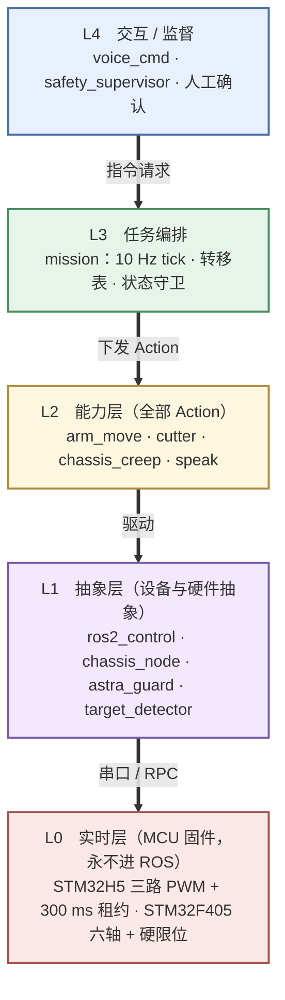

**要点**

- 实线是**指令向下**：每一层只调用下一层的接口，不知道下下层存在。
- **状态向上走但不构成依赖**：`targets` / `hazards` / `robot_state` 从 L1 流到 L3，
  `safety_supervisor` 对 L3 有全局否决权（图 3、图 8）。
- L3 只是"决定下一步做什么"，它**不认识串口、相机、MoveIt**。
- 每次跨层都是 Action（有 goal / feedback / result / cancel / 超时），不是"发一条 topic 然后猜"。

> 各层内部构件、进程、话题、TF 关系分别见图 2、图 3、图 4。

---

## 图 2 · 运行时进程与 CPU 拓扑

一句话：**会动的各占一个进程；控制钉 A78C，视觉语音钉 A55。**

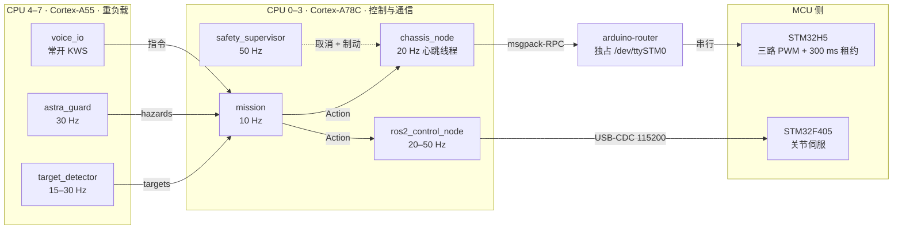

**要点**

- `chassis_node` 的心跳线程**独立于 ROS 回调**，executor 卡住也能继续喂狗或主动刹车。
- `arduino-router` 是系统服务，不是我们写的节点；它独占底盘串口（见 §6.5）。
- 任一进程崩溃，其下游看门狗在 500 ms 内接管。

---

## 图 3 · 通信拓扑（话题 / 动作 / 服务）

一句话：**每个执行器只有一个写者。**

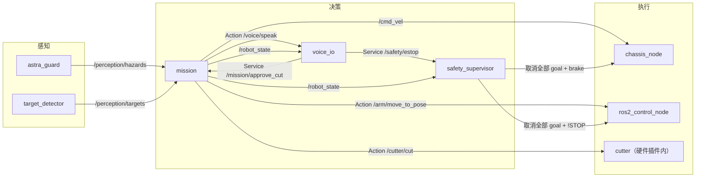

**要点**

- `chassis_node` 是 `/cmd_vel` 的**唯一**订阅者与底盘串口的**唯一**写者。
- `ros2_control` 是六轴的唯一写者；`/cutter/cut` 在硬件插件内部实现，**不再另开串口**。

---

## 图 4 · TF 树

一句话：**`base_link` 保持=机械臂基座（现有 MoveIt 配置零改动）。**

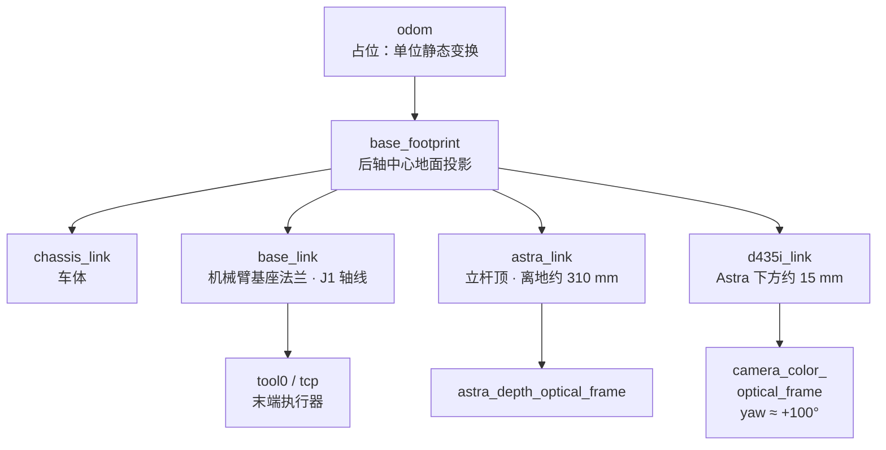

**要点**

- `odom → base_footprint` 现在是假的（无编码器），但**预留了位置**：将来加编码器或 VIO，下游一行不改。
- 所有静态参数放 `pickorange_bringup/config/transforms.yaml`，**不写死在 launch 里**。
- 旧的手眼外参（`cam_x=-0.1959 …`）**整体作废**，必须重标。

---

## 图 5 · 采摘任务状态机

一句话：**10 Hz tick 驱动，状态 × 事件 → 下一状态，跳步由守卫拒绝。**

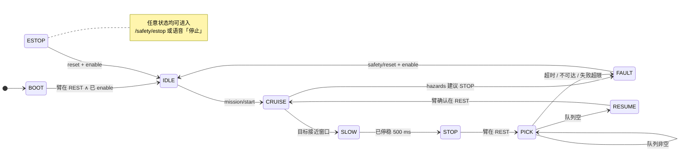

**PICK 内部子状态（线性，同样显式）**

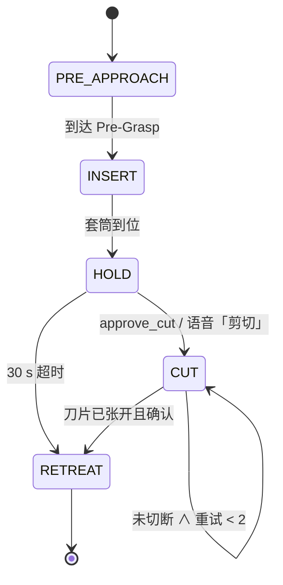

**要点**

- `HOLD` 是唯一等人工的稳定态，且**必须可超时**（30 s 无确认自动退刀）。
- `RETREAT` 的前提是 `final_angle == home`（刀片已张开），否则会扯断枝条。

---

## 图 6 · 一次连续采摘的时序

一句话：**一次停车采完队列里的所有目标，中途可被语音打断。**

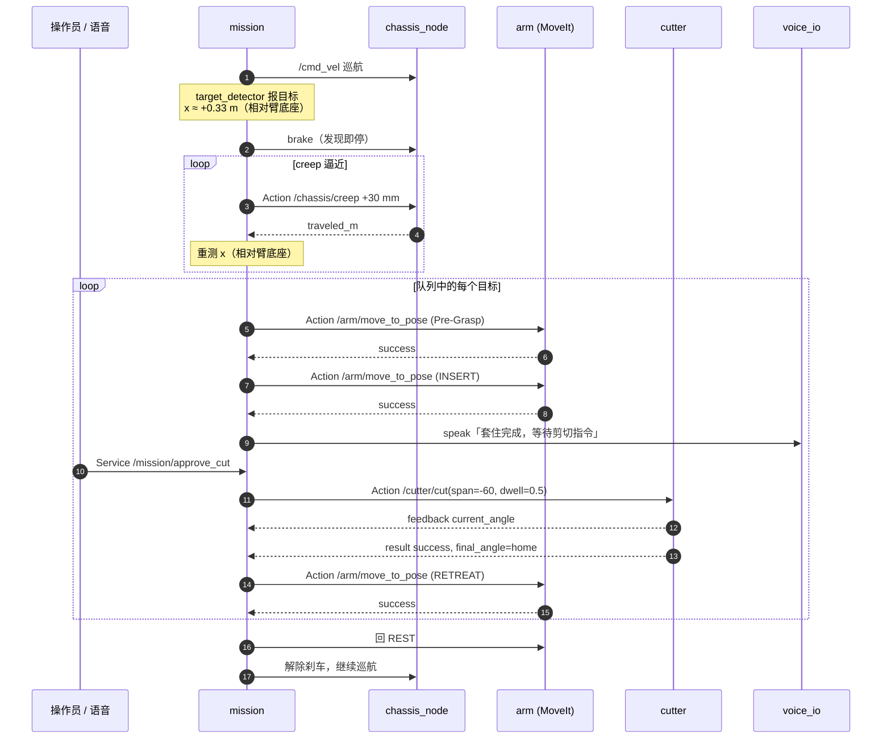

**要点**

- 停车分两段：**发现即停**（宁可停早）+ **creep 闭环逼近**（每步 3 cm，每步重测）。
- 剪切是原子操作：合刀 → 保压 → **张刀** → 确认到位。
- 队列非空时**不回 REST**，直接从退刀位去下一个 Pre-Grasp。

---

## 图 7 · 停车逼近控制流

一句话：**停早了可以蠕进，开过了要倒车——所以策略偏向早停。**

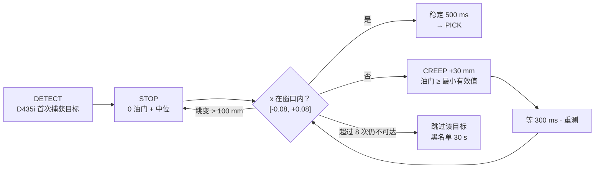

**要点**

- 每步 3 cm，**误差不会累积超过一步**，天然免疫"没有里程计"。
- 每步都用视觉重新测量 ⇒ `throttle→v` 标定不准也无所谓。
- **油门有最小值**：实测 15% 车不动、30% 才起步。所以 creep 只能"走一小段再停"，
  不能用极低油门"慢慢挪"——那会变成发着指令不走，最后超时。
- "跳过"是一等公民：卡在一个摘不到的果子上是这类系统最常见的死锁。

---

## 图 8 · 安全与心跳链

一句话：**四重冗余，任何一层崩了车都会停。**

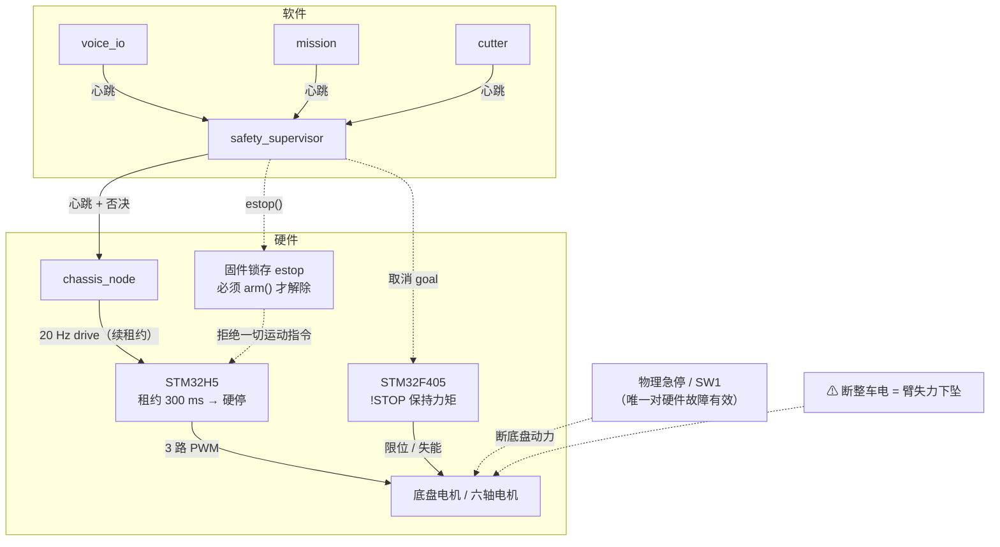

**要点**

- `/safety/estop` 的语义是 **"底盘锁存停车 + 机械臂 `!STOP` 保持力矩"**，**绝不失能、绝不切电**。
- **锁存在固件里**：即使控制程序崩溃前正在 20 Hz 猛发 `drive()`，每条指令也会返回 `false`。
- **软件链只覆盖软件故障。** 档位信号浮空/越界可能让车继续前进，这只能靠物理急停。
- 物理断电仍须先把机械臂收回 REST。

---

## 图 9 · 语音指令通路

一句话：**语音只能触发"能力层已有 + 安全层放行"的动作，且移动必须是有限步进。**

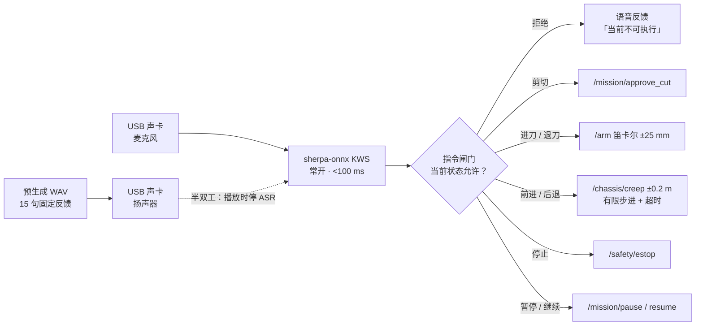

**要点**

- **绝不允许**"开始前进直到我说停"这种开放指令。
- 回环自激用**半双工**解决：播放期间停 ASR（丢帧而非缓存）。
- 固定反馈语全部预生成 WAV，零延迟零 CPU；TTS 模型只服务临时文本。

---

## 图 10 · 相机安装几何（俯视）

一句话：**相机在臂前方、又朝后侧方，两个偏置恰好抵消——目标最像"侧方"时正好落在臂的可达区。**

> 这张是几何图，用 ASCII 表达比 Mermaid 清楚。数值为当前推算，待 S0 实测确认。

```text
                       车头 ↑ +X
                                
        ┌───────────────────────────────────────────────┐
        │        [Astra]  ▲ 正前方（避障，只测距离）       │
        │           │                                   │
        │           │ 70 mm（立杆中心 → 臂底座中心）        │
        │           ↓                                   │
        │      ┌─────────┐                              │
        │      │ 机械臂   │  ← base_link（J1 轴心）       │
        │      │ 基座     │                              │
        │      └─────────┘                              │
        │           ·                                   │
        │           · 可采窗口                           │
        │           · x ∈ [-0.10, +0.10] m              │
        │           · y ∈ [ 0.25,  0.42] m              │
        │           ·                                   │
        │      ╲                                        │
        │       ╲ 87° 视场                              │
        │        ╲                                      │
        │         ╲        [D435i]  光轴 ≈ 100°（左偏后） │
        │          ╲         ╱                          │
        └───────────╲──────╱───────────────────────────┘
                     ╲    ╱
                      目标

  换算（已核算，详见 architecture_v2.md §3.5）：
      相机相对臂底座：(+0.070, −0.040) m
      光轴方向：(cos100°, sin100°) = (−0.174, +0.985)

      x = 0.070 − 0.174·d
      y = −0.040 + 0.985·d

      d = 0.40 m → (x, y) = (0.000, +0.354)  ✅ 窗口中心
      d = 0.60 m → (x, y) = (−0.034, +0.552)  ❌ 超臂展

  结论：目标在相对臂底座 x ≈ +0.33 m 时才首次进入视场
        （车头前方约 13 cm），到窗口只剩 33 cm 行程
        ⇒ 巡航阶段是「侧扫」不是「前视」⇒ 不能远距离预判
```

**要点**

- 这也是为什么停车必须"发现即停"，而不是"提前减速"。
- 可采窗口 = **D435i 视锥 ∩ 机械臂可达包络**，是 S1 最需要实测标定的几何量。

---

## 图 11 · 落地里程碑

一句话：**每一步都能单独验收，且都有一组明确的阻塞问题。**

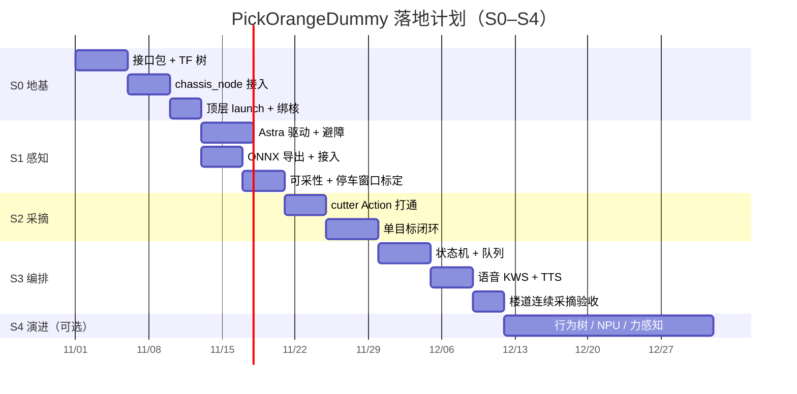

**验收标准**

| 阶段 | 一句话验收 |
|---|---|
| S0 | 一条命令起来，RViz 看到车+臂+两相机，`/cmd_vel` 能让车走 |
| S1 | 画面出现橘子 → RViz 出 3D 球 + 可采标记；Astra 报出正确前方距离 |
| S2 | 手动触发完成 套→等确认→切→张刀→退刀，全程无超时强杀 |
| S3 | 楼道挂 3 个橘子，一键启动连续采 3 个，语音可暂停/停止 |

> 日期是**按无阻塞问题的乐观估计**；实际以 §22 的 22 项待确认问题的答复速度为准。

---

## 图源与重新生成

每个图的 Mermaid 源在 [`diagrams/*.mmd`](diagrams/)，同名 `.svg` / `.png` 是渲染产物。
本文档里的代码块与 `.mmd` 内容一致——**改图改 `.mmd`，再重新渲染**。

渲染用 gstack 的离线 mermaid 渲染器（不需要联网）：

```bash
cd ~/01_MyProject/PickOrangeDummy
STAGED=/tmp/gstack-render/$(basename ~/.config/opencode/skills/gstack/lib/diagram-render/dist/diagram-render.html)

# 单张
f=docs/diagrams/04-tf.mmd; n=$(basename $f .mmd)
SRC=$(base64 < $f | tr -d '\n')
GSTACK_CHROMIUM_NO_SANDBOX=1 bun run ~/.config/opencode/skills/gstack/bin/gstack-render.ts \
  "/tmp/gstack-render/gstack-diagram-render-$(shasum -a 256 ~/.config/opencode/skills/gstack/lib/diagram-render/dist/diagram-render.html | cut -c1-16).html" \
  --wait-selector '#done' \
  --eval "window.__renderMermaid('d', decodeURIComponent(escape(atob('$SRC')))).then(s => (window.__svg = s))" \
  --out docs/diagrams/$n.svg \
  --eval "window.__rasterize(window.__svg, 1950)" --out docs/diagrams/$n.png
```

**Mermaid 排版注意**（踩过的坑）：

- 子图之间**有连线时**，`direction LR` 会被忽略，节点会竖着堆成一列。跨子图的图要用
  张量级（subgraph 到 subgraph）的边，或者干脆不分层用单列。
- 如果不想装渲染器，GitHub 会直接渲染本文档里的 ` ```mermaid ` 代码块，效果一致。
