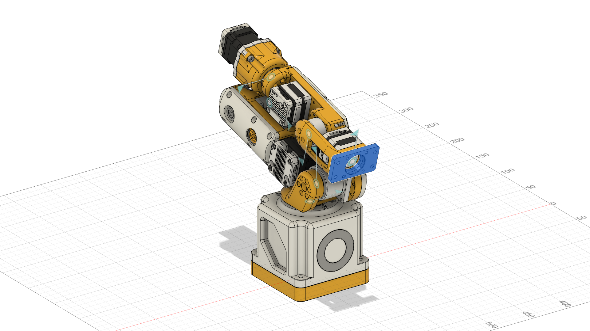

# Dummy_ForURDF — Robot Description



## Overview

| Property | Value |
|----------|-------|
| Total mass | 9.325 kg |
| Links | 7 |
| Joints | 6 (6 movable) |
| Assemblies | 17 |
| Root link | `base_link` |

## Table of Contents

- [Kinematic Tree](#kinematic-tree)
- [Link Properties](#link-properties)
- [Joint Properties](#joint-properties)
- [Assembly Breakdown](#assembly-breakdown)
- [Quick Start (ROS 2)](#quick-start-ros-2)
- [Files](#files)

## Kinematic Tree

```
base_link [BAKE]
  └─ _1 [revolute]
    J1_2 [BAKE]
      └─ _2 [revolute]
        J2J3_2 [BAKE]
          └─ _3 [revolute]
            J4_2 [BAKE]
              └─ _4 [revolute]
                35_20Motor_Assembly_2 [BAKE]
                  └─ _5 [revolute]
                    35_20Motor_Assembly_1_2 [BAKE]
                      └─ _6 [continuous]
                        3 [BAKE]
```

## Link Properties

| Link | Mass (kg) | Material | Collision | Bodies |
|------|-----------|----------|-----------|--------|
| `3` | 0.0738 | material | box | 1 |
| `35_20Motor_Assembly_1_2` | 0.4100 | material | box | 3 |
| `35_20Motor_Assembly_2` | 0.9672 | material | box | 3 |
| `J1_2` | 0.4287 | material | box | 1 |
| `J2J3_2` | 2.6124 | material | box | 1 |
| `J4_2` | 1.0214 | material | box | 1 |
| `base_link` | 3.8116 | material | sphere | 1 |

## Joint Properties

| Joint | Type | Parent → Child | Axis | Limits |
|-------|------|---------------|------|--------|
| `_1` | revolute | `base_link` → `J1_2` | (0,0,1) | [0.0°, 340.0°] |
| `_2` | revolute | `J1_2` → `J2J3_2` | (0,0,1) | [265.0°, 360.0°] |
| `_3` | revolute | `J2J3_2` → `J4_2` | (0,0,1) | [-145.0°, 0.0°] |
| `_4` | revolute | `J4_2` → `35_20Motor_Assembly_2` | (0,0,1) | [-180.0°, 180.0°] |
| `_5` | revolute | `35_20Motor_Assembly_2` → `35_20Motor_Assembly_1_2` | (0,0,1) | [-95.0°, 95.0°] |
| `_6` | continuous | `35_20Motor_Assembly_1_2` → `3` | (0,0,1) | — |

## Assembly Breakdown

### 

- **Links**: 
- **Total mass**: 0.000 kg

### 35Motor_Driver

- **Links**: 
- **Total mass**: 0.000 kg

### 35Motor_Driver_1

- **Links**: 
- **Total mass**: 0.000 kg

### 35Motor_Driver_2

- **Links**: 
- **Total mass**: 0.000 kg

### 35_20Motor_Assembly

- **Links**: 35_20Motor_Assembly_2
- **Total mass**: 0.967 kg

### 35_20Motor_Assembly_1

- **Links**: 35_20Motor_Assembly_1_2
- **Total mass**: 0.410 kg

### 35_28Motor_Assembly

- **Links**: 
- **Total mass**: 0.000 kg

### 42_34Motor_Assembly

- **Links**: 
- **Total mass**: 0.000 kg

### 42_34Motor_Assembly_1

- **Links**: 
- **Total mass**: 0.000 kg

### 42_40Motor_Assembly

- **Links**: 
- **Total mass**: 0.000 kg

### Dummy_ForURDF

- **Links**: 3
- **Total mass**: 0.074 kg

### J1

- **Links**: J1_2
- **Total mass**: 0.429 kg

### J2J3

- **Links**: J2J3_2
- **Total mass**: 2.612 kg

### J4

- **Links**: J4_2
- **Total mass**: 1.021 kg

### J5

- **Links**: 
- **Total mass**: 0.000 kg

### J6

- **Links**: 
- **Total mass**: 0.000 kg

### base_link

- **Links**: base_link
- **Total mass**: 3.812 kg

## Quick Start (ROS 2)

```bash
# 1. Copy package to your ROS 2 workspace
cp -r Dummy_ForURDF_description ~/ros2_ws/src/

# 2. Build
cd ~/ros2_ws
colcon build --packages-select Dummy_ForURDF_description
source install/setup.bash

# 3. Visualize in RViz2
ros2 launch Dummy_ForURDF_description display.launch.py

# 4. Validate URDF structure
check_urdf install/Dummy_ForURDF_description/share/Dummy_ForURDF_description/urdf/Dummy_ForURDF.urdf

# 5. Print kinematic tree
urdf_to_graphviz install/Dummy_ForURDF_description/share/Dummy_ForURDF_description/urdf/Dummy_ForURDF.urdf
```

**Joint control**: The launch file includes `joint_state_publisher_gui` —
use the sliders to move revolute/prismatic joints in RViz2.

**Topic inspection**:
```bash
# See published joint states
ros2 topic echo /joint_states

# See robot description parameter
ros2 param get /robot_state_publisher robot_description
```

## Files

| Path | Description |
|------|-------------|
| `urdf/Dummy_ForURDF.urdf.xacro` | Top-level xacro (entry point) |
| `urdf/Dummy_ForURDF.urdf` | Flat URDF (for validation) |
| `urdf/assemblies/` | Per-assembly xacro macros |
| `meshes/` | Visual (OBJ) and collision (STL) meshes |
| `launch/display.launch.py` | Launch robot_state_publisher, RViz, and generated controllers |
| `config/joint_state.yaml` | Joint state publisher config |
| `config/ros2_controllers.yaml` | Generated ros2_control controller manager config |
| `robot_data.yaml` | Supplementary data (beyond URDF) |
| `docs/transforms.md` | Transformation matrices (KaTeX) |

## Customizing

Assemblies tagged `!dummy_` are designed to be swapped out. To replace one:

1. Create your replacement as a xacro macro with the same interface
2. Place it in `urdf/assemblies/`
3. Update the `<xacro:include>` in `urdf/Dummy_ForURDF.urdf.xacro`
4. Update meshes in `meshes/<your_assembly>/`

The xacro prefix system (`${prefix}`) ensures link names stay unique
when multiple instances of the same assembly are used.

---
*Generated by Fusion URDF/XACRO Exporter v3.1.0*